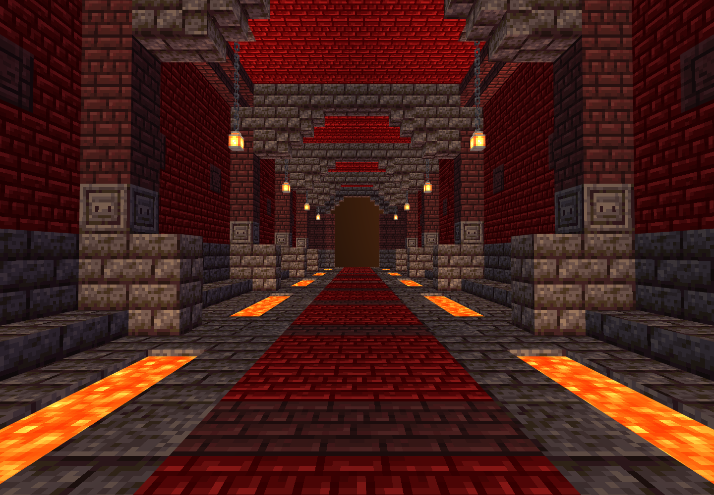

# M01 狱火拱廊 · 独立交付

**状态：制作、静态 QA、四向内部/外壳软件视图、Minecraft 1.20.1 / Forge 47.4.10 原生四向放置及 200 tick 稳定性通过；未接入或部署。**

## 四项主交付

- `room.nbt`：gzip、DataVersion 3465、单调色板，15×13×40，完整 7,800 格记录（含显式空气）。
- `room.json`：尺寸、原图指纹、双端口、玩家脚部坐标、主路与材料清单。
- `preview.png`：实际 NBT 的 Minecraft Builder / Lodestone 0.6.0 一点透视软件渲染，不是 AI 图，也不是 Minecraft 客户端截图。
- `qa.json`：总验收结果和细分证据索引。

## 几何与设计

南北 Z 轴直通，长 40 格（2.5 区块），没有转弯、分岔或路面楼梯。入口脚位 `[7,2,0]`，内部安全脚位 `[7,2,3]`，出口脚位 `[7,2,39]`；脚下完整方块地板 y=1。主路 x=5..9，脚位 y=2，始终至少三格净高；两端中央五格宽、七格高。不使用关闭的门挡住通道。阶梯方块仅在高处拱肋/檐口作饰件，不构成步行楼梯。

按原图落实红色地狱砖墙、黑石基座与六组拱肋、红色中轴铺装、五对铁链吊灯、双侧分段低槽熔岩。原索引同时给出 intact 与 broken-arches，采用完整承重外壳和台阶式拱肩，不在主路制造坍塌。48 格真实岩浆均位于主路两侧的 y=1 低槽、有实心底和侧壁；主路安全不代表可踏入岩浆。没有容器、战利品、刷怪笼、实体或命令方块。

设计图：`D:/ft工程文件/image2.5/dungeon-corridors-20261103/out/M01-nether-intact.png`。

原图 SHA-256：`625157979074e1cedb8e14c9d4b8616d3a507004a759b509f6a76a20ead22be2`。

NBT SHA-256：`ec735669a5ac8951a374457bae72b880886368fcc204feb3ebdd7fd4116f37e6`。

## 真实验证证据

- `qa/static.json`：边界/唯一坐标、完整顶底、40 片同高五格宽路线、无侧向开口、岩浆围护、吊灯支撑、零实体和奖励等 20 项静态检查。
- `views/eye-north.png`、`views/eye-south.png`：双端眼平视角。`views/interior-{north,east,south,west}.png` 和 `views/exterior-{north,east,south,west}.png`：四向内部与完整外壳，共 8 张。
- `views/interior-sheet.png`、`views/exterior-sheet.png`：两张四向总览。内部图仅在内存移除屋顶和近侧外墙，最终 NBT 未剖切。所有截图由真实 NBT 加载，`qa/views.json` 记录源指纹、相机与图片 SHA-256。
- `qa/native.json`、`qa/forge-gametest.log`：隔离 GameTestServer 在 NONE / CLOCKWISE_90 / CLOCKWISE_180 / COUNTERCLOCKWISE_90 四向原生 placeInWorld；先校验 7,800 格，强制区块 tick、触发邻居更新和熔岩 tick，再运行 200 tick 后核对全部 31,200 格。四向均维持 296 个可达脚位、48 格受限岩浆、10 盏有支撑灯、600 格屋顶，外部流体和掉落/实体均为 0。
- `qa/native-placed-*.nbt`：四个实际世界回采模板，逐格与对应旋转源模板一致，重新原生加载通过，指纹在原生报告中。
- 占用显式空气格、拆吊灯支链、阻塞主路、去掉岩浆底板的负向探针各 4 次均被检测。探针仅发生在隔离夹具内，复原后才开始稳定性计时。这不是生产核心占用/幂等集成验收。
- 首次编译误用了游戏规则映射常量，已改为 1.20.1 的 `RULE_DAYLIGHT` 并完整重跑通过；保留 `qa/attempt-1-compile.log`。Gradle 弃用和初始化时过载警告不等于整合包 FPS 测试结果。

## 复现

1. 在 `C:/Users/YOUR_USERNAME/.codex/skills/minecraft-builder-skill` 目录运行 `node scripts/run-build.mjs <本交付>/tools/recipe.mjs --out-dir <本交付> --name room --data-version 3465 --json`。
2. `node <本交付>/tools/qa-static.mjs` 生成元数据和静态报告。
3. 用 PowerShell 执行 `tools/run-native.ps1`，使用本机 Java 17、Gradle 8.8 缓存与 Forge 47.4.10，仅写 `native-qa/run-isolated`。
4. 用技能 `scripts/preview.mjs --nbt <本交付>/room.nbt --no-open --port 5191` 开始本地预览，再运行 `node tools/render-views.mjs`。截图用无头 Edge，不启动玩家客户端。
5. 用配置的 Python 运行 `tools/make-sheet.py`，核对两张总览；`node tools/finalize.mjs` 检查证据与指纹后写总报告和 `SHA256SUMS.txt`。

## 接入边界

未部署 JAR、未写 mods、未修改核心源码、未打开或修改任何正式存档；所有新内容只在本 M01 目录内。`native-qa` 是验证夹具，严禁部署到正式实例。

接入方必须先检测完整 15×13×40 体积（包括显式空气）、世界边界、原有流体和实体，拒绝占用而不是无条件清空；保留独立持久化标记和既有玩家修改，双端口与方块状态按同一原生旋转变换。未宣称完成 FT 主干道路连接、返程门逻辑、完整整合包实机游玩、多人或帧率验证。
