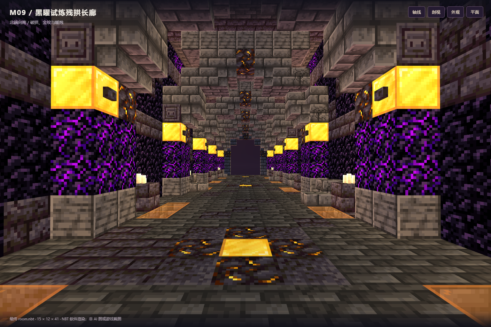
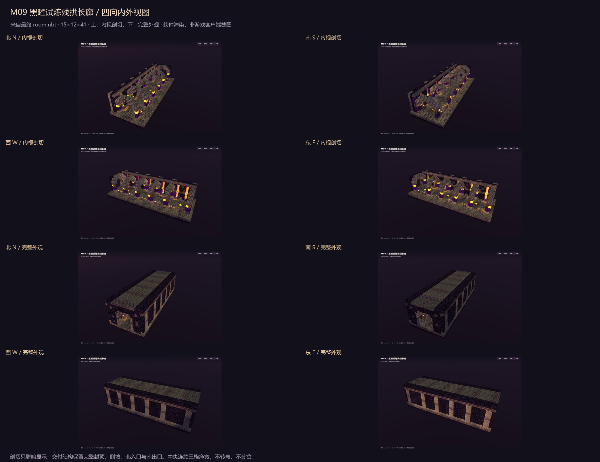

# M09 · 黑曜试炼残拱长廊

**独立交付完成，静态 / 四向内外视图 / Forge 四向放置稳定性 QA 均 PASS。未部署，未打开或修改玩家存档。**

## 四件套

- `room.nbt`：gzip、Java 1.20.1、DataVersion 3465、单一调色板、7380 条显式方块记录（含空气）。
- `room.json`：尺寸、双端连接口、脚部坐标、原图指纹、结构完整 SHA-256、接入约束。
- `preview.png`：最终 NBT 的 Lodestone / WebGL 轴线渲染，不是 AI 原图或游戏客户端截图。
- `qa.json`：最终验收总报告、证据路径、回采状态核对与各文件指纹。



## 尺寸与连接

| 项目 | 数值 |
| --- | --- |
| 尺寸 XYZ | **15 × 12 × 41** |
| 中型长度 | **41 格 = 2.5625 区块**，符合 32–48 格要求 |
| 北入口脚部 | **[7, 2, 0]**，朝北 |
| 内部安全脚位 | **[7, 2, 3]** |
| 南出口脚部 | **[7, 2, 40]** |
| 双端开口 | 5 格宽 × 5 格高，拱顶另有收口 |
| 必需净通行 | **X=6…8，Y=2…4，Z=0…40**，连续 3 格宽 × 3 格高 |

一字贯通、无转弯、无分岔、主路无楼梯。地面 Y=1、脚部 Y=2；严禁把入口脚位误当脚下地板。完整基础 Y=0、封闭屋顶 Y=11。图中剖切仅用于预览，不改变最终 NBT。

## 参考与建筑转译

- 原图：`D:\ft工程文件\image2.5\dungeon-corridors-20261103\out\M09-obsidian-trial-damaged.png`。
- 原图 SHA-256：`485e717ae64f6bc8b0ba8ba59512a904b2bc43fced70389aa6df650440f70de9`，已实读验证，与 manifest 一致。
- 已核对参考项目 README、SPEC、manifest、`out/corridor_index.json`、M09 提示词。
- 黑曜石与哭泣黑曜石墙身、六组重复深板岩拱、金色符板与黑石浮雕、12 组点燃的多烛烛台。
- 三处拱肩缺损、裂砖与墙边碎石；不是堵塞主路的坍塌，也没有打穿屋顶。
- **熔岩光缝采用橙色玻璃 + 包封菌光体安全转译**，没有真实熔岩、岩浆块、明火、液体或危险方块。
- 金纹以原版金块 / 镶金黑石 / 黑石按钮表现；不提供自定义纹理、着色器、文字贴图、试炼战斗或奖励逻辑。
- 没有生图调用、容器、战利品、刷怪笼、实体、命令方块、结构方块或拼图方块。

## QA 证据

1. **静态 9/9 PASS**：原图指纹、gzip/版本/单调色板、边界与完整记录、无实体危险载荷、直路、双端开口、基础屋顶侧墙、烛台与符板支撑、主题构件；见 `qa/static.json`。
2. **四向内外视图 PASS**：北/南/西/东各一张内视剖切和完整外观，另有正反轴线、平面、原生回采轴线，共 12 张最终 NBT 软件视图；见 `views/`、`qa/render.json`、`qa/visual-review.json`。
3. **Forge 47.4.10 / Minecraft 1.20.1 / Java 17.0.8 PASS**：隔离临时 GameTest 世界，使用原生 `StructureTemplate.placeInWorld` 的 NONE、CLOCKWISE_90、CLOCKWISE_180、COUNTERCLOCKWISE_90 四向放置；240 tick 后逐项严格比较 **29520 条记录**，检查碰撞、支撑、地板、封顶、侧墙、123 个脚位 / 方向和无掉落实体。
4. **稳定性 PASS**：tick 200 与 240 快照完全一致。四向回采还原朝向后与最终 NBT 所有方块及原有状态属性一致；原生补全的默认方块属性不误判为漂移。回采见 `qa/native-placed-*.nbt`。
5. **负向探针 PASS**：每方向分别临时堵主路、移除烛台支撑，均准确判失败后恢复；各 4 次。只在新建隔离测试世界执行。
6. 控制台保留 `M09_FORGE_QA_PASS`、`All 1 required tests passed`、`BUILD SUCCESSFUL`。Forge 在线版本检查超时、新世界默认配置修正、Gradle 弃用警告不影响此结果。



## 复现

所有生成和 QA 源码仅属于本交付，Minecraft Builder 安装位置为 `C:\Users\YOUR_USERNAME\.codex\skills\minecraft-builder-skill`。从本交付目录执行：

```powershell
node 'C:\Users\YOUR_USERNAME\.codex\skills\minecraft-builder-skill\scripts\run-build.mjs' '.\recipe.mjs' --out-dir '.' --name room --data-version 3465 --json
node '.\tools\audit.mjs'
& 'C:\Users\YOUR_USERNAME\.cache\codex-runtimes\codex-primary-runtime\dependencies\python\python.exe' '.\tools\run_forge.py'
node '.\tools\preview-server.mjs'
```

本地预览服务启动后，在另一个终端执行：

```powershell
node '.\tools\capture.mjs' --native
& 'C:\Users\YOUR_USERNAME\.cache\codex-runtimes\codex-primary-runtime\dependencies\python\python.exe' '.\tools\contact_sheet.py'
node '.\tools\finalize.mjs'
```

预览 URL 写入 `qa/preview-server.json`，仅绑定 `127.0.0.1`；依赖已安装的 Lodestone/Vite、打包 Playwright 与本机 Edge。Forge 采用缓存 Gradle 8.8、原版 1.20.1 mappings 和 Forge 47.4.10；`run_forge.py` 每次创建新测试目录并使用随机端口，绝不复用玩家世界。`forge/` 是 QA 源码，不要放入整合包 mods。

## 接入边界

这次只制作独立模板，不接入核心、目录、入口路线，不部署 JAR，也不打开玩家存档。**不把隔离 Forge 验证或软件视图冒充整合包客户端实机游玩。**

未来由核心负责人验证整体占用、世界边界、液体/实体、南北连接位置与持久生成标记。先检查整个 **15×12×41** 体积，再决定是否施工；即使模板明确记录空气，也不得据此无条件清空已占用世界。新增模板不能覆盖已生成房间或玩家修改。本次不声称已完成连通接入、占用拒绝、幂等或联机/FPS 验收。

日期：2026-11-03（Asia/Shanghai）。
