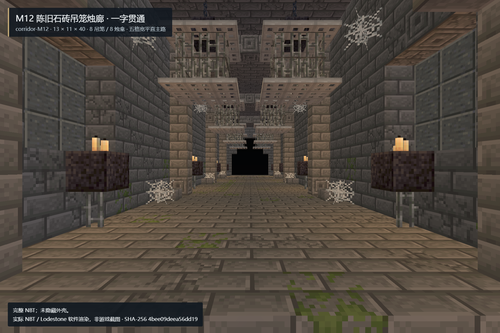

# corridor-M12 · 陈旧石砖吊笼烛廊

独立中型直走道候选，使用 Minecraft Builder skill / Lodestone 0.6.0 生成 Java 1.20.1 gzip 单调色板结构。仅交付本目录，不部署、不改正式模组、玩家存档或其他房间。

## 设计与坐标

- 尺寸 X×Y×Z：**13×11×40**，Z 轴贯通，长度 2.5 区块；无转弯、分岔和行走楼梯。
- 北入口脚位 `[6,1,0]`，内部安全脚位 `[6,1,3]`，南出口脚位 `[6,1,39]`；北为 -Z。
- 保证主路：`x=4..8, y=1..4, z=0..39` 全空气，脚下 y=0 全实心；五格宽、四格净高、同一水平面。
- 陈旧灰石砖、裂纹与少量苔砖，5 道柱拱，8 个铁链吊笼、8 个三烛壁龛、角落蛛网与边缘碎石。没有液体、容器、战利品、方块实体或生物。
- 13×40 的地板和屋顶全部保留；四向剖切只临时隐藏近侧墙和部分屋顶，不修改 NBT。
- 概念图：`D:/ft工程文件/image2.5/dungeon-corridors-20261103/out/M12-stone-brick-aged.png`；副本为 `reference.png`。
- 概念图 SHA-256：`d525bbd2f9b7059a2ae60caf736231c753665a1b2b6c906194e497fa83db0e8f`。
- 最终 NBT SHA-256：`4bee09deea56dd19329a8306be98abef532187b3a711d46aca3dacbe4b722fcb`。

## 交付与证据

| 文件 | 用途 |
| --- | --- |
| `room.nbt` / `room.json` | 最终结构及相对坐标、设计指纹、候选 ID |
| `preview.png` | 从实际最终 NBT 渲染的一点透视完整内部图 |
| `preview/cutaway-{north,south,west,east}.png` | 四向内部剖视 |
| `preview/exterior-{north,south,west,east}.png` | 四向完整外壳 |
| `preview/eight-view-review.png` | 四向内外检查总览 |
| `qa.json` | 当前指纹的统一 QA 结论和边界 |
| `qa/static.json` / `qa/materials.json` | 静态断言与方块材料数量 |
| `qa/native.json` / `qa/native-run.json` | 实际 Forge 四向放置及延迟复验结果、运行日志指向 |
| `qa/four-view-review.json` / `qa/render.json` | 四向视觉复核及每张图的渲染来源与相机 |
| `delivery-manifest.json` | 独立文件清单与完整 SHA-256 |
| `corridor-M12-independent.zip` | 不含 Gradle 缓存和隔离测试世界的交接包 |

软件预览不是整合包客户端截图；Lodestone 的光照与烛火显示不等同于游戏。Forge QA 使用 Minecraft 1.20.1 / Forge 47.4.10 的独立 GameTestServer，通过真实 `ServerLevel` 与 `StructureTemplate.placeInWorld`，不是模拟 JavaScript 放置。每个方向检查 5,720 条记录、原生注册表与属性、完整顶盖、支撑、5×4 贯通净空、外围留白、无实体掉落；触发邻居更新并等待 400 tick 后逐记录复验。四方向合计 22,880 条记录。

这不代表完整整合包多人、战斗、返程门、FPS 或实际接入道路验收；最终接入由统一协调线程另行安排。

## 复核修订

首轮静态/原生检查后，四向剖视识别出三道内部柱拱的六处顶部缺格。已填充柱顶，新增静态及 Forge 实心面衔接断言，再生成全部视图并复跑原生验收。旧结构、旧 QA 与拒绝理由保留在 `qa/revision-01/`，不得把旧指纹报告当作最终验收。

修订后一次原生测试因新生成的隔离世界地形占用 y=99 测试边界，被占用拒绝正确中止；记录见 `qa/environment-rejection.json`。未清理地形，改为 y=300 空中夹具并完整重跑，失败日志保留，不算通过证据。以 `qa/native-run.json` 指向的最后成功运行和 `qa/native.json` 的最终指纹为准。

## 重现

本机预置 Java 17、Gradle 8.8、ForgeGradle 缓存、Minecraft Builder、Edge 与 Playwright；生成不调用付费生图。

```powershell
& 'D:\ft工程文件\FT地牢_Image25接入_20261101\deliveries\corridor-M12\Run-QA.ps1' -Rebuild
node 'D:\ft工程文件\FT地牢_Image25接入_20261101\deliveries\corridor-M12\tools\render-views.mjs'
& 'C:\Users\YOUR_USERNAME\.cache\codex-runtimes\codex-primary-runtime\dependencies\python\python.exe' 'D:\ft工程文件\FT地牢_Image25接入_20261101\deliveries\corridor-M12\tools\finalize.py' --sheets
```

若 NBT 指纹变化，必须重新完成四向视觉复核，更新相应报告；最后执行 `tools/finalize.py`（不加 `--sheets`）才会核验各阶段指纹并重新打包。运行脚本只生成本目录下的独立测试世界；不会读取或打开玩家世界。全量运行日志保留最初缺省 `server.properties`、Forge 首次配置自修复、过时 API 警告与测试期间负载告警，不把这些日志冒充完整整合包性能结论。

## 接入边界

1. **候选 ID 是 `corridor-M12`，不是已有的 `M12` 菌菇地窖。** 不覆盖其他交付或现有房间标记；正式唯一 ID/槽位尚未分配。
2. NBT 显式记录全部 5,720 个坐标（含空气），接入前必须对完整体积、周边液体、实体和道路净空做占用拒绝，禁止直接覆盖已有建筑。
3. 两端都需接到同高安全地板，保持中央五格宽净空；旋转用原生结构模板旋转方块状态，不手改面对属性。
4. 不包含部署脚本、正式模组 JAR、玩家世界或新的战斗/奖励逻辑。外壳为地下嵌入式封闭石砖结构，吊笼是空装饰。


