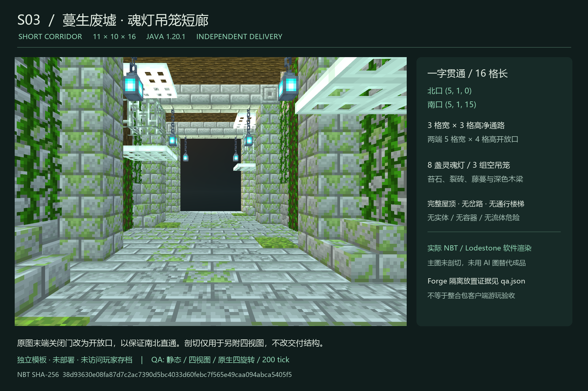

# S03 · 蔓生废墟短廊

独立交付：`room.nbt`、`room.json`、`preview.png`、`qa.json`。**不部署、不修改核心源码、不访问或修改玩家存档。**

## 结构

- Minecraft Java 1.20.1 / DataVersion 3465；gzip 单调色板结构；Minecraft Builder / Lodestone 0.6.0 配方生成。
- 尺寸 **11×10×16**，短档长 16 格。北入口 `[5,1,0]`，南出口 `[5,1,15]`；坐标均为脚部位置，地板 y=0。
- 中心沿 +Z 完全贯通，x=4..6 保留 3 格宽、3 格高净通路；两端开放口至少 5 格宽、4 格高。无分岔、无转弯、无通行楼梯。
- 保留原图苔绿裂砖、密集墙藤、深色梁柱、8 盏灵魂吊灯、3 组空铁吊笼。原图末端关闭木门改为开放口，避免把概念图封堵照搬进走道。
- 完整地板、双层侧墙、屋顶；四视图的西/东图仅对渲染副本剖切，不改 NBT。装饰边角用了楼梯方块模拟碎石，不构成通路或楼层变化。
- 1760 条显式全体积记录，1181 个非空气方块。没有实体、方块实体、容器、刷怪笼、战利品、命令/结构/拼图方块或危险流体。

## 参考与指纹

原图：`D:/ft工程文件/image2.5/dungeon-corridors-20261103/out/S03-overgrown-ruins-overgrown.png`。

原图 SHA-256：`f33bb90a2418cf5d68bc2bc894e9931af8d3d54a6cb8285f7b3c30d9c8e3e1d2`。

NBT SHA-256：`38d93630e08fa87d7c2ac7390d5bc4033d60febc7f565e49caa094abca5405f5`。

已核对批次 README、manifest、SPEC、索引和 S03 提示词。交付内附原图副本与源文档指纹；本次没有调用任何付费生图接口。

## 验收与边界

- 静态 NBT：尺寸、所有坐标唯一性、显式体积、两端开口、3×3 笔直净空、封闭侧墙、完整地板/屋顶、无危险内容、附着物支撑均通过。
- 四视图：`qa/four-views.png`；原始 6 张结构渲染在 `qa/views/`。主图为同一最终 NBT 的中轴眼平视图，未剖切。软件 WebGL 渲染不是游戏客户端截图。
- 原生 Forge 47.4.10 隔离 GameTest：4 个旋转实放，共每轮 7040 条记录；Minecraft 注册表、状态值、模板往返、全部非空气方块原生支撑、玩家碰撞通路、200 tick 稳定性和测试夹具还原均通过。日志 `qa/forge-gametest.log`。
- 藤蔓允许原生自然生长/面状态更新；4 轮主动随机刻和 200 tick 后四方向分别产生 1/4/3/6 处自然变化，无结构方块损失。复测增长数可不同。
- 测试世界只位于本目录的 `native-test/run/s03-isolated-gametest/world`；没有打开正式实例或玩家存档。这不是完整整合包客户端、多人、FPS 或 FT 路网接入验收。
- 模板含显式空气，**接入负责人必须检查完整 11×10×16 体积、流体、世界边界及实体，遇占用拒绝，不得以空气覆盖或清空解决冲突**。本交付没有赋予任何生产施工权限。

## 复测

`Run-QA.ps1` 复跑静态与隔离 Forge 原生测试；`-Rebuild` 先用已安装 Minecraft Builder 重新生成结构。使用 Java 17 和本机现有离线 Gradle 缓存。

视觉复测：从已安装 Builder 目录运行 `node scripts/preview.mjs --nbt <本目录绝对路径>/room.nbt --no-open`，把打印的本机 URL 作为 `node tools/render_views.cjs <URL>` 的参数。随后 `python tools/package_delivery.py --compose-only` 合成图并人工检查；更新 `qa/visual-review.json` 后再运行不带参数的打包脚本。

`corridor-S03-independent.zip` 包含四件套、全部 QA 证据、源配方与隔离测试源码/Gradle wrapper，不打包测试世界、构建缓存或测试模组 JAR。`delivery-manifest.json` 列出每件文件的完整 SHA-256。

