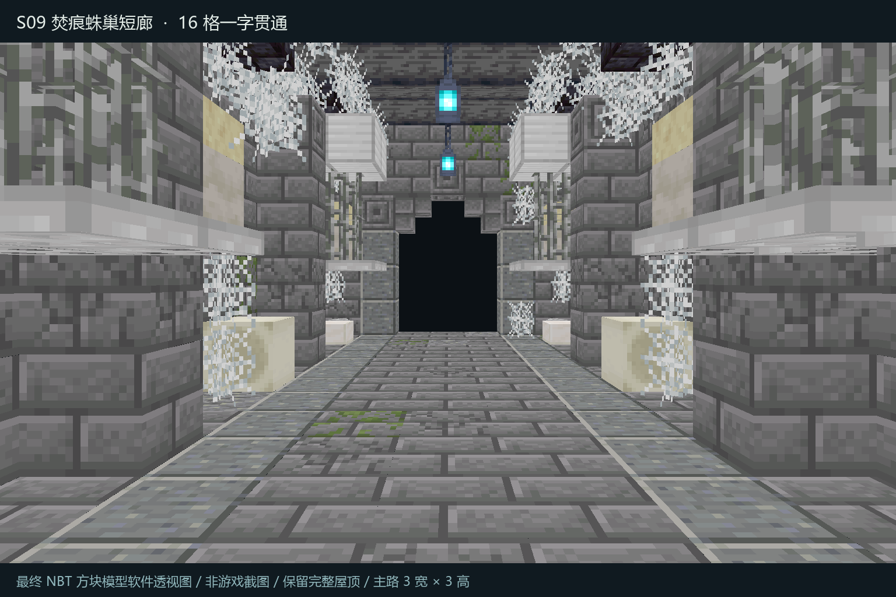
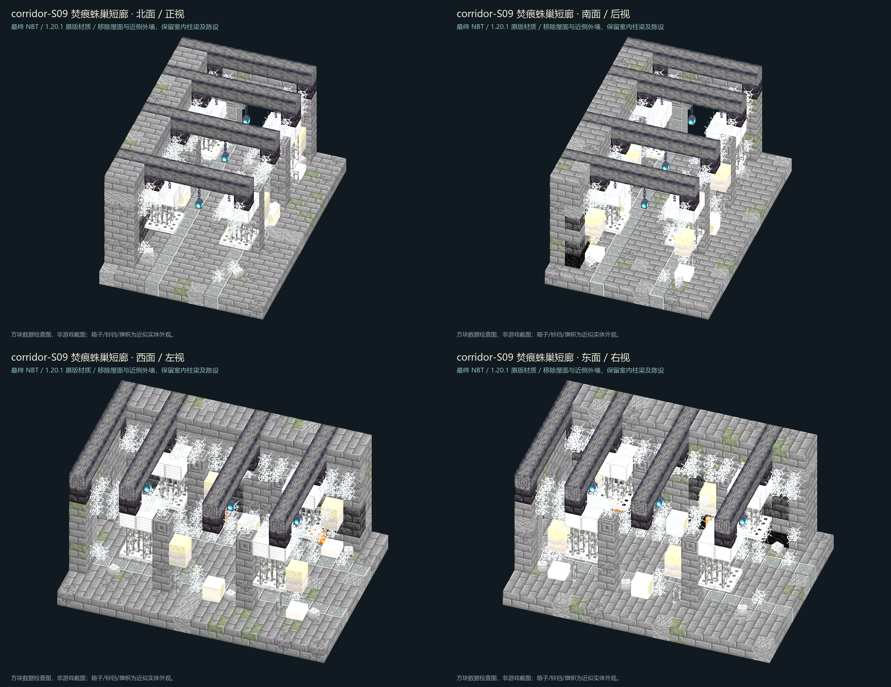
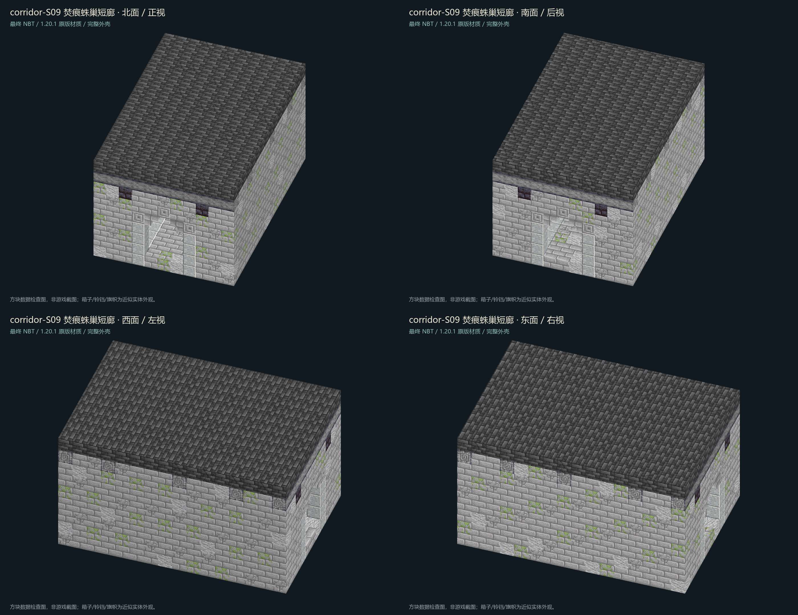

# corridor-S09 · 焚痕蛛巢短廊

独立 Java 1.20.1 走道模板，Minecraft Builder / Lodestone 制作。**16 格短直廊，无转弯、岔路或楼梯；已完成制作与独立验收，未部署、未分配正式槽位、未修改玩家存档。**

## 四件套与指纹

- `room.nbt`：gzip、单调色板、DataVersion 3465，尺寸 **11×9×16 (X×Y×Z)**，1584 条完整体积记录（包含显式空气）。
- `room.json`：入口、安全点、出口、通道尺寸、原图指纹和接入约束。
- `preview.png`：最终 NBT 的北向居中眼平透视，保留屋顶；不是概念图或游戏截图。
- `qa.json`：聚合验收终态；静态、八视图检查和 Forge 四向稳定性证据均绑定同一 NBT。

最终 NBT SHA-256：`c03ecabc108e734e0c7d61e6c6b57b0cc1496fabb57e7db141423f0386df6025`。

原图：`D:/ft工程文件/image2.5/dungeon-corridors-20261103/out/S09-webbed-spider-burnt.png`；SHA-256：`eeb80b6a2cf8e64e3ec92740ed43119b714b7b9e72d671c339484cfd886d6c26`，已验证 1536×1024 PNG 可读取。批次规范、索引及提示词均从同一批次目录只读参考；未调用付费生图。



## 通路与设计转译

模板原点是地板层 y=0；脚部坐标：北入口 `[5,1,0]`，安全点 `[5,1,2]`，南出口 `[5,1,15]`。**x=4..6、y=1..3、z=0..15 全部净空**，即 3 宽×3 高×16 长。两端开口各 3×3，地板完整，往返可走；四向原生旋转后仍一致。铁笼、蛛网、骨堆、卵囊仅在两侧或头顶高处，不侵入主路。

保留灰石砖、苔/裂纹、冷蓝灵魂灯、厚蛛网、四只吊笼、六处骷髅与骨碎片、墙上卵囊及焦痕。原图尽头的关闭木门改为开放石拱，满足“一字贯通”。卵囊用蘑菇柄/砂岩半砖表达；烧焦横梁使用不可燃玄武岩，余烬用封边菌光体壁龛表达，不使用真火、岩浆或熔岩。笼子是静态装饰，不是刷怪器、陷阱或战利品。

## 验收证据

- `qa/static.json`：指纹、格式、坐标边界、完整体积、3×3×16 净空、双向通路、176 格地板/176 格屋顶、侧壳、吊灯/铁链/笼体/骨堆与卵囊依附全部通过；保守平面步行检查可达 66 个脚位。
- `views/interior-{north,south,west,east}.png` 和 `views/exterior-{north,south,west,east}.png`：最终 NBT 的四向内部剖视及完整外壳；各有 `*-four-views.png` 拼图。`views/manifest.json` 记录 NBT 和每张图片指纹；`qa/visual-review.json` 是逐项目视检查结论。
- `qa/forge-native.json` 和 `qa/forge-run.log`：**Minecraft 1.20.1 / Forge 47.4.10 隔离 GameTest 实际放置通过**。0/90/180/270 度四向均保留全部 1584 条状态；强制邻接/形状更新后继续观察 **240 tick**，无变化、无掉落。各向真实碰撞可达 66 脚位，完整通路、地板屋顶外壳、7 条锚定铁链、3 盏灯、4 只笼、36 铁栏、16 关闭活板门底板、16 铁块笼盖、6 个原生骷髅方块实体通过。
- 初版自动铁栏连接未通过原生测试，已修正并保留拒绝证据：`qa/rejected-lodestone-auto-bars/`、`qa/revision-history.json`。通过原生检查后，目视又发现笼底/笼盖与栏杆的分数方块细缝，已改为上半活板门底板与整铁块笼盖，消除上下接缝，并重新完成静态、全视图及 Forge 复验；前版证据保留在 `qa/previsual-cage-joints/`。




软件视图使用 1.20.1 原版方块模型/材质，骷髅采用近似模型，不模拟游戏完整动态光照。隔离 Forge 测试不是完整整合包客户端、FPS 或多人游玩验收。测试世界仅位于本交付 `forge/run/s09-isolated/`，不打开正式实例的任何玩家世界。没有容器、库存、战利品表、预置实体、刷怪笼、命令/拼图方块或新战斗脚本。

## 重建与复验

在 `C:/Users/YOUR_USERNAME/.codex/skills/minecraft-builder-skill` 目录执行（依赖已安装）：

```powershell
node scripts/run-build.mjs 'D:/ft工程文件/FT地牢_Image25接入_20261101/deliveries/corridor-S09/source/build-s09.mjs' --out-dir 'D:/ft工程文件/FT地牢_Image25接入_20261101/deliveries/corridor-S09' --name room --data-version 3465 --no-block-state-updates
```

**必须保留 `--no-block-state-updates`**：配方已按原生规则显式计算铁栏连接，防止自动更新再次把蛛网判为可连接实心邻居。

在本交付目录，用已有 Pillow 的 `C:/Users/YOUR_USERNAME/.codex/.venvs/imagegen/Scripts/python.exe` 依次运行 `source/qa-s09.py --prepare`、`source/render-s09.py`、`source/render-eye.py`；再运行 `source/run-forge.ps1`。此 Python 环境仅借用 Pillow，未访问任何图像 API。四向软件渲染脚本只读调用既有共享 `tools/review_four_views.py` 及其归档渲染依赖/本地 1.20.1 client.jar。Forge 使用已有 Gradle 8.8、Java 17 缓存，离线构建，工程与运行目录均限于 S09。只有重新目视确认并更新视觉证据后才运行 `source/qa-s09.py --finalize`。

## 统一接入边界

使用唯一 ID **corridor-S09**，不要与旧房间 S09/S9 或其它批次 ID 混用。正式槽位和连接路线留给统一接入负责人分配。首次放置必须对 **11×9×16 完整体积**做世界占用、液体、实体和边界检查；显式空气只为模板完整性，不授权覆盖玩家建筑或无条件清空。不得把已生成房间重复覆盖，不修改正式 JAR、mods、资源包、KubeJS 或玩家 SavedData。本交付仅提供可复验模板，不宣称已在 FT 大厅接入。

`corridor-S09-delivery.zip` 为轻量交接包：包含四件套、八视图/透视、源码、QA 和隔离测试源码配置；排除 Forge 构建缓存与测试世界。
