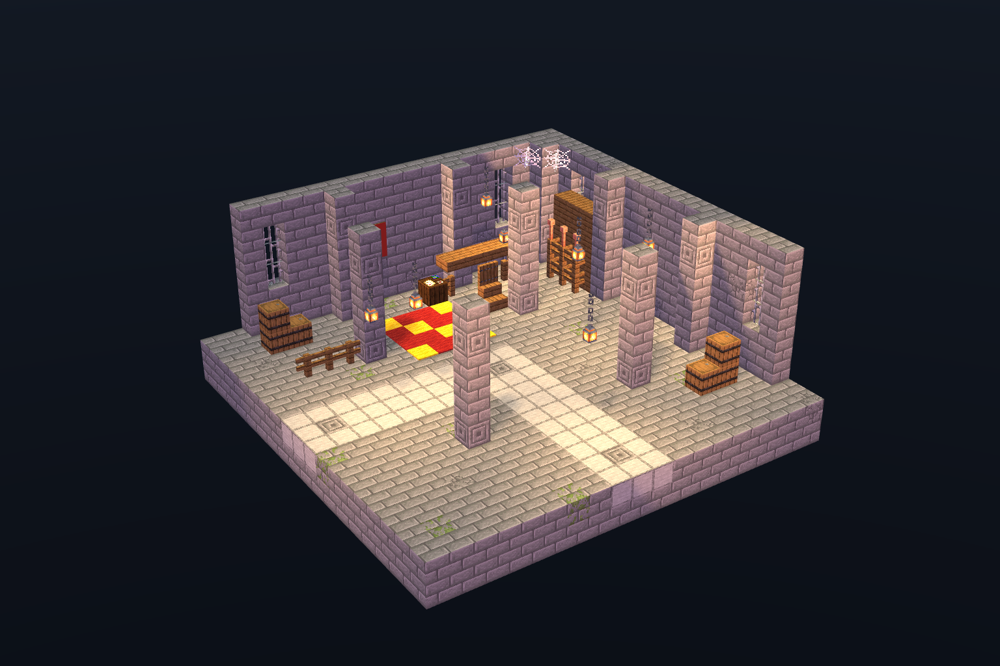
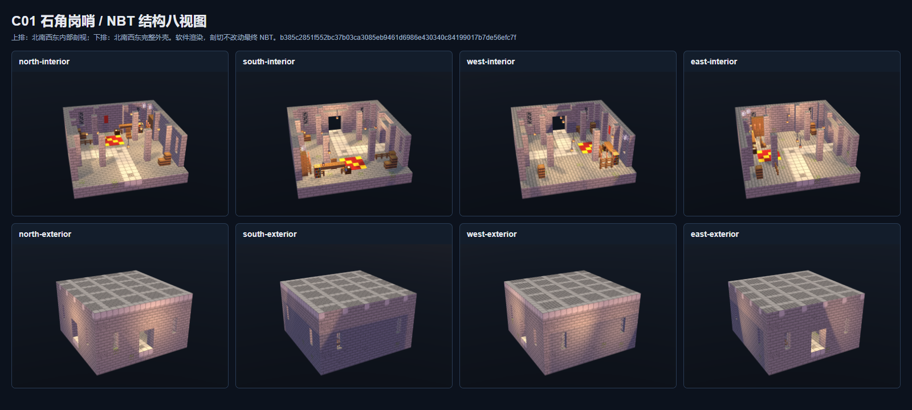

# C01 石角岗哨

本目录为独立地牢拐角房间交付，日期 2026-11-03。实际结构由 Minecraft Builder / Lodestone 配方生成，全部使用 Minecraft Java 1.20.1 原版方块。没有部署、改动正式存档/JAR/资源包/配置，也没有修改其它房间交付。

## 成品与指纹

- [room.nbt](room.nbt)：gzip 单调色板结构，DataVersion 3465，尺寸 **19×11×19**，3971 条显式记录，其中 2207 条非空气。
- NBT SHA-256：**b385c2851f552bc37b03ca3085eb9461d6986e430340c84199017b7de56efc7f**。
- [room.json](room.json)：入口、出口、安全落点、旋转后接口、设计来源与接入前置条件。
- [preview.png](preview.png)：实际 NBT 剖视软件渲染；[qa.json](qa.json)：最终验收汇总与证据哈希。

## 接口与行走

局部坐标按 +X 东、+Y 上、+Z 南。下列坐标均为玩家脚部，地板在 y=1。

| 项目 | 坐标 / 范围 |
| --- | --- |
| 北入口 | [9,2,0]，门洞 x=8..10、y=2..5、z=0..1 |
| 内部安全落点 | [9,2,3]，其周围 x=8..10、z=2..4 连续平整 |
| 拐弯中心 | [9,2,9] |
| 东出口 | [18,2,9]，门洞 x=17..18、y=2..5、z=8..10 |
| 出口内部安全点 | [15,2,9] |
| 主路 | 三格宽、至少三格净高，57 个连通脚位；北入后向东转弯，可逆向行走 |

| 旋转 | 入口朝向 | 出口朝向 | 归一到旋转包围盒最小角的入口 | 出口 | 安全落点 |
| --- | --- | --- | --- | --- | --- |
| NONE | 北 | 东 | [9,2,0] | [18,2,9] | [9,2,3] |
| CLOCKWISE_90 | 东 | 南 | [18,2,9] | [9,2,18] | [15,2,9] |
| CLOCKWISE_180 | 南 | 西 | [9,2,18] | [0,2,9] | [9,2,15] |
| COUNTERCLOCKWISE_90 | 西 | 北 | [0,2,9] | [9,2,0] | [3,2,9] |

后续接入者须先检查完整 19×11×19 目标体积（含模板中的显式空气）、实体及液体，发现占用就拒绝；使用独立持久标记，不覆盖玩家修改。外接道路与地板 y=1、玩家脚部 y=2 对齐。本交付不执行接入施工。

## 验收证据

- [静态检查](qa/static.json)：17 项通过；坐标完整、无重复、单调色板、完整双层屋顶与地板、三宽拐角通路、安全落点、四根连续石柱、7 盏支撑灯具、6 个空桶、无实体/战利品表/危险或管理方块。
- [八视图总览](views/review-sheet.png)：上排北/南/西/东内部剖视，下排北/南/西/东完整外壳；另有 [俯视](views/top-interior.png)。[渲染报告](qa/render.json) 记录每张图的视角、源 NBT 指纹和图片哈希。剖切只隐藏显示副本，外壳视图读取完整源 NBT。
- [Forge 原生报告](qa/forge.json)、[运行日志](qa/forge-run.log)：Minecraft 1.20.1 / Forge 47.4.10，独立 GameTest 四向实际 StructureTemplate.placeInWorld 放置；放置后对全部记录的六个方向执行原生形状更新和邻居通知，再等待 **160 tick**。
- 四方向每间 3971 条记录，共 **15884 条**逐项保持一致；各方向 57 个通路脚位通过玩家碰撞检查；全部方块通过 canSurvive，屋顶/地板完整，无液体和掉落实体。缺失吊灯支撑及堵路的负向探针各 4 次通过。
- [原生世界快照](qa/captures/) 留有四种旋转的 NBT；[方块实体复核](qa/capture-block-entities.json) 从快照核对全部 24 个空桶、4 面旗帜的图案及颜色。原生模板往返文件为 [native-roundtrip.nbt](qa/native-roundtrip.nbt)。
- 独立 Forge 验证属于原生服务端证据；软件图不等于客户端截图，未宣称完整整合包客户端、多人或 FPS 验收。

## 设计来源与偏差

原图：D:/ft工程文件/image2.5/dungeon-zone-batch-20261103/out/corners/C01-corners-stone-corner-watchpost.png。

原图 SHA-256：142725fdc2c276c07c3929fa9f5151cc1341ab226dd91686d070a0ca10a1d8cb。已与批次 README、manifest.json、verify.json 核对。

保留风化石砖、独立岗哨石柱、箭窗铁栏、红金地毯与旗帜、地图桌椅、武器架、支撑灯笼及墙边存储。概念展示剖面补为完整双层石屋顶；新增北入口和东出口形成可接入的直角动线；图中的台阶降差改为齐平地板。手绘地图、纸张和矛尖以原版制图台、书架和铜制避雷针武器架近似，不生成物品或实体。六个存储桶全部为空。Lodestone 对旗帜花纹的显示有限，图中可见红布；原生四份世界快照已核对金色图案 NBT。

初次失败和中间候选保留在 qa/rejected-initial/、qa/rejected-fixture-contamination/、qa/pre-final-chair/。最终已修正椅背与石柱相交、椅背与座面接缝；测试夹具清理外围旧方块及历史掉落物后重新执行全部核验。

## 复现

在本目录运行，使用现有已安装技能依赖和 Forge 缓存：

~~~powershell
node C:/Users/YOUR_USERNAME/.codex/skills/minecraft-builder-skill/scripts/run-build.mjs source/recipe.mjs --out-dir . --name room --data-version 3465 --compression gzip --json
node source/finalize.mjs
node source/static-qa.mjs
node source/render.mjs
./source/run-forge.ps1
node source/verify-captures.mjs
node source/package-qa.mjs
~~~

测试模组仅在本目录 native/ 编译，测试世界仅位于 qa/forge-run/world。勿把测试模组或该世界作为正式房间部署。
