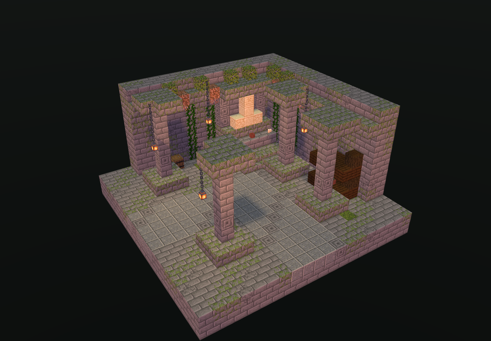

# C03 蔓生角落神龛 · 独立交付

状态：制作、19 项静态 QA、四向内部剖视/完整外壳软件视图、Forge 四向实际放置和 240 tick 稳定性通过。未接入、未部署。

## 四件套

- room.nbt：Minecraft Java 1.20.1，gzip，DataVersion 3465，单调色板；19×12×19，全体积 4,332 条记录，含 1,563 格显式空气。
- room.json：尺寸、原图指纹、双端口、脚部坐标、五格宽主路、安全点、材料和四向变换后的接入坐标。
- preview.png：从实际 NBT 生成的 Lodestone 软件剖视图。
- qa.json：最终检查结果和证据索引。

## 几何与设计

北侧中央入口脚位 [9,2,0]，室内安全点 [9,2,4]、[13,2,9]，东侧中央出口脚位 [18,2,9]。脚下实心地板 y=1，两端开口均五格宽、五格高，主路至少五格宽、三格净高，同高九十度转弯，无门阻挡。y=10、11 为完整双层屋顶。

按原图保留苔石墙、四根独立落地石柱、砂岩角落神像、分层石祭台、双烛与供器、木架盆栽、空木桶、红色旗帜、铁链暖灯、贴墙藤蔓、垂根与持久杜鹃树叶。藤蔓的每个启用面均有直接实墙背衬，神像至基础连续承重，四盏灯通过三格铁链接屋顶；植物装饰避开主路。原版方块尺度限制下，供品用空花盆表达，细小蘑菇用有支撑盆栽表达；不生成物品实体、战利品或刷怪笼。

原图：D:/ft工程文件/image2.5/dungeon-zone-batch-20261103/out/corners/C03-corners-overgrown-corner-shrine.png

原图 SHA-256：66ec2c533d55317d11a79016865dd7dc6c3b7c19d24d5786cc09d8508bbc9d27

NBT SHA-256：de59629577403c50075f606284cddfb40c0d1612d5cbbee95657822a0f9c2ad2

## 验证证据

- qa/static.json：19 项检查，包括全体积唯一坐标、完整基础/屋顶、入口/出口与安全点往返、95 个主路脚位、藤蔓直接背衬、神龛与四根石柱承重、木架支撑、灯链、垂根、空容器和原图哈希。静态严格空气 BFS 为 143 格，原生碰撞 BFS 为 162 格；差值来自原生允许穿行的无碰撞装饰。
- views/interior-{north,east,south,west}.png、views/exterior-{north,east,south,west}.png：四向内部剖视和完整外壳；另有双入口眼平图及神龛近景。共 11 张原始截图、两张四向总览。qa/views.json 记录相机和每张图片指纹；qa/image-decode.json 验证解码；qa/visual-review.json 记录人工视图核对。剖切只发生在预览内存，不修改交付 NBT。
- qa/forge-native.json、qa/forge-run.log：Minecraft 1.20.1 / Forge 47.4.10 / Java 17 的独立 GameTestServer，四向 StructureTemplate.placeInWorld 放置、注册表/属性/方块实体原生解码和往返、邻居更新、240 tick 后检查 17,328 格。每向保留 58 格藤蔓、4 盏灯、3 个空桶和1面装饰旗；零流体、掉落物和额外实体，200 与 240 tick 世界快照一致。
- 每向对堵路、拆藤蔓直接背衬、拆神像承重、拆灯链四种负向探针进行真实检测，共 16 次，并在计时前复原夹具。
- qa/native-placed-*.nbt：四份世界回采模板。qa/capture-comparison.json 独立比对全部 17,328 格及 16 份方块实体内容，确认原图案旗保留、容器为空；回采 NBT 经过原生重载。
- qa/attempt-1-native.json、qa/attempt-1-forge.log：保留首次失败证据。首次测试的藤蔓负向探针只调用 canSurvive，藤蔓可从上方藤蔓继承支撑，因此探针未能识别直接背衬缺失。已改为逐启用面核对实墙后完整重跑；房间 NBT 没有变化。最终运行日志为 BUILD SUCCESSFUL。
- SHA256SUMS.txt：四件套、源码、截图和 QA 证据的 SHA-256；不包含可再生 Gradle 缓存和隔离测试世界。

## 复现

1. 在 C:/Users/YOUR_USERNAME/.codex/skills/minecraft-builder-skill 运行 node scripts/run-build.mjs <本目录>/tools/recipe.mjs --out-dir <本目录> --name room --data-version 3465 --json。
2. node <本目录>/tools/static-qa.mjs。
3. PowerShell 执行 tools/run-forge.ps1。仅运行本目录 forge/run/c03-isolated，绝不能将验证模组安装到玩家实例。
4. 技能目录运行 node scripts/preview.mjs --nbt <本目录>/room.nbt --no-open --port 5273，再运行 node <本目录>/tools/render-views.mjs。用本机配置 Python 执行 tools/make-sheet.py。
5. node tools/verify-captures.mjs，再 node tools/finalize.mjs。重新截图后须重新目视检查并更新 qa/visual-review.json 才可定稿。

## 接入边界

仅在 zone-C03 内交付；未写 mods、未改 FT 核心、未打开或修改正式玩家存档、未覆盖并行房间。接入方必须检查旋转后的整个 19×12×19 体积，包括显式空气、世界边界、既有流体和实体，发现占用即拒绝，禁止无条件清空。使用独立 C03 持久化生成标记并保留玩家修改。旋转以 BlockPos.ZERO 为轴，坐标与状态必须同时变换，部分朝向的相对足迹为负，room.json 的 rotated_ports 给出边界与脚位。

软件渲染不是客户端实机截图；隔离 Forge 验证不是完整整合包、多人与 FPS 测试。自然随机生长关闭以检验放置/支撑稳定性，邻居与计划 tick 正常运行。未宣称完成大厅接路、返程门或核心占用/幂等集成验收。

