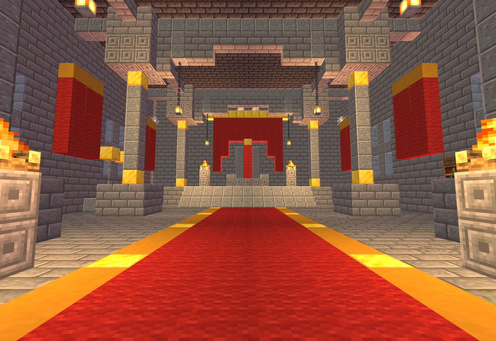

# H01 残金王座大厅 · 独立分区交付

制作及独立验收通过，未接入或部署。Minecraft Builder / Lodestone 0.6.0 生成 Java 1.20.1 原版结构；Forge 47.4.10 隔离 GameTestServer 四向放置和 200 tick 稳定性通过。

## 四件套

- `room.nbt`：29×18×33，gzip，DataVersion 3465，单调色板，17,226 格完整记录（含显式空气）。
- `room.json`：原图、尺寸、脚部坐标、唯一北端口、王座台、材料和设计偏差。
- `preview.png`：最终 NBT 的北入口眼平视图，由技能自带 Lodestone / WebGL 生成。
- `qa.json`：总验收及证据索引；所有证据绑定同一个 NBT SHA-256。

## 接入参数

北开口五格宽、六格净高，x=12..16、y=2..7、z=0..1。入口脚位 `[14,2,0]`，内部安全脚位 `[14,2,4]`，脚下地板 y=1。主路 x=12..16、z=0..22，同高且至少三格净高。王座台通过 z=23、y=2 和 z=24、y=3 的朝南底半楼梯上行，落脚区 y=4；王座前安全脚位 `[14,4,26]`。其余侧面封闭，本房间是单北口的终端大厅。

六根石柱连续连接底座与顶梁，六盏铁链吊灯有完整锚固；四座营火火盆离开主路，放在石质高座。保留红金垂幔、王座、两级高台、冷色窗格、书架、空木桶和无实体武器陈设。六格空木桶无战利品表；六面原版装饰旗有金边/金圆纹。无怪物、刷怪笼、命令方块或结构实体。

## 参考与指纹

参考图：`D:/ft工程文件/image2.5/dungeon-zone-batch-20261103/out/halls/H01-halls-throne-hall-dais.png`。

参考图 SHA-256：`5b1cd83ecf19000c21254810b1e571d63ed0fde16c12a0fd09601a925c01f492`。

最终 NBT SHA-256：`2cf72715954f54dcb2425b0c9e72742b48dc59bcc2c0292405409636a4bd6c16`。

核对了批次 `README.md`、`docs/manifest.json`、`docs/verify.json`；后两份 H01 记录与实际 PNG 一致，来源指纹见 `qa/reference-provenance.json`。

## 证据

- `qa/static.json`：28 项静态检查，包括完整体积、顶底、唯一端口、主路、两级楼梯、柱梁支撑、灯链、离路火盆、空容器等。
- `views/interior-{north,south,west,east}.png` 和 `views/interior-sheet.png`：四向内部剖视，只在渲染内存中去掉屋顶和近侧双层外墙，保留室内柱梁陈设。
- `views/exterior-{north,south,west,east}.png` 和 `views/exterior-sheet.png`：最终未剖切外壳，双层屋顶完整。
- `views/eye-north.png`、`views/throne-detail.png`：北入口眼平视角与王座近景。
- `qa/views.json`：渲染相机、图片哈希、最终 NBT 哈希及零浏览器脚本错误；`qa/image-decode.json`：十张原图解码检查；`qa/visual-review.json`：四向和两张近景的人工视觉核看记录。
- `qa/native.json`、`qa/forge-gametest.log`：Forge 47.4.10 原生四方向 `placeInWorld`、注册表/属性/方块实体校验、邻居更新、强制区块 tick 后运行 200 tick，再逐格检查 68,904 格。
- 每个方向用 0.6×1.8 玩家碰撞盒、0.25 格路径采样验证五条并行路线双向往返；楼梯最大半格抬升，共每方向 1,090 个采样。四个安全脚位可站，六盏灯、四个火盆、六个空桶、六面装饰旗始终有效，无流体或掉落实体。
- `qa/native-placed-*.nbt`：四个真实隔离世界回采结构，逐格与旋转源模板一致并原生重载。显式空气占用拒绝、移除灯链、堵塞中轴的负向探针各四次都检出。

这些是软件渲染和隔离 Forge 原生验证证据；尚未在正式整合包中接通主干路线、验证返程逻辑或进行客户端游玩。初次隔离世界预生成出现服务器负载警告，测试随后通过；这不构成正式实例帧率数据。

## 设计偏差

1. 原图为剖视展示，实际补齐北立面及双层屋顶；只留五格宽北入口。
2. 红毯用齐平红羊毛配黄陶/金块边线落实，保持接入口整数脚位；台阶采用两级可行走原版楼梯。
3. 自由布幔、圆柱和徽记按整方块改为红羊毛垂幔、金边石柱、原版金花纹旗。
4. 艺术火盆改为石座营火，武器架为铁栏加金饰的无实体陈设；木桶不分发战利品。
5. 按通行尺度落实为29×18×33格，保留五格中轴、家具侧通道，调整了窗格和部分陈设比例；未追求像素级复刻。

## 复现

1. 在 `C:/Users/YOUR_USERNAME/.codex/skills/minecraft-builder-skill` 运行 `node scripts/run-build.mjs <本目录>/tools/recipe.mjs --out-dir <本目录> --name room --data-version 3465 --json`。
2. 运行 `node <本目录>/tools/qa-static.mjs`，再执行 `<本目录>/tools/run-native.ps1`。首次证据世界为本目录 `native-qa/run-isolated-h01`；复跑脚本使用带时间戳的新世界，避免触碰旧测试记录。使用 Java 17、Gradle 8.8 和已有 Forge 缓存。
3. 用技能 `scripts/preview.mjs --nbt <本目录>/room.nbt --no-open --port 0` 启动预览，读取实际 URL，再运行 `node <本目录>/tools/render-views.mjs <URL>`。
4. 使用带 Pillow 的 Python 运行 `tools/make-sheets.py`；核看图像后运行 `node tools/finalize.mjs` 封装证据清单。

## 边界

所有产物限定在本 `deliveries/zone-H01`，未修改并行房间、正式 JAR、资源包、配置和玩家存档。`native-qa` 是一次性验证夹具，不能安装到玩家实例。

接入方先验证完整29×18×33体积（包括空气格）、世界边界、流体和实体，遇到占用拒绝施工。入口脚位和方块状态必须用同一个原生旋转；保留每间持久化生成标记，已生成房间不覆盖玩家修改。本交付不执行部署。
