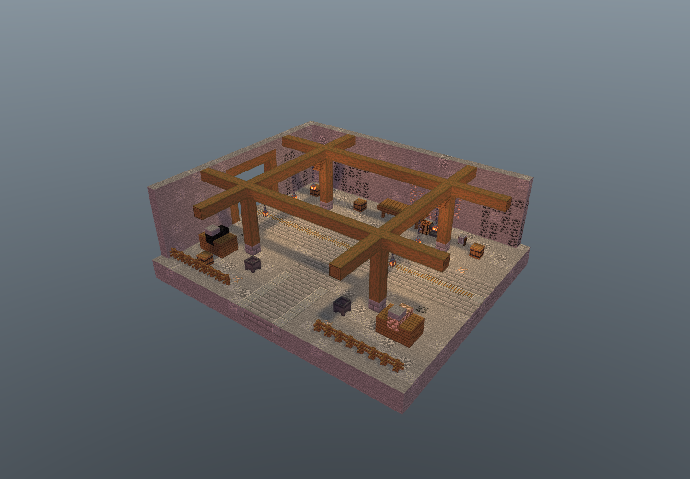

# zone-M01 活跃矿道 · 独立分区房间

已完成：静态 QA、真实 NBT 四向内部/外壳视图、Minecraft 1.20.1 / Forge 47.4.10 原生四旋转放置与 200 tick 稳定性。状态 PASS，未部署或接入。ID 为 zone-M01，来源为 dungeon-zone-batch-20261103，不与 corridor-M01 共用 ID。

## 四项主交付

- room.nbt：gzip、DataVersion 3465、27×11×23，6831 个唯一显式格记录，包括空气。
- room.json：原图/批次证据、完整材料、端口和玩家脚部坐标。
- preview.png：Minecraft Builder / Lodestone 加载最终 NBT 后生成的内部剖切软件图。
- qa.json：总验收报告，链接静态、原生、回采、视图与哈希证据。

## 房间与坐标

地板 y=1，玩家脚位 y=2。南侧入口 [13,2,22]，安全点 [13,2,18]。南口宽 5、高 5；东西轨道口各宽 5、高 5。东西铁路 27 格，沿 x=0..26、z=10、y=2；两侧步道 z=8,9 与 11,12，保持三格净高。南侧五格宽通路 x=11..15、z=13..22；158 个保证路线格，原生碰撞 BFS 有 489 个同高可达脚位，可到双侧轨道口、南口、安全点和后部作业区。

四根木柱在 [6,2,5]、[6,2,16]、[20,2,5]、[20,2,16] 的石砖基座上，纵向木柱接入 y=8 横梁网格；六盏吊灯均由双节铁链接至梁底。y=9 木质顶棚与 y=10 石质屋顶分别完整覆盖 621 格。矿石墙、空木桶、工作台、铁砧、砂轮、侧边分拣箱与围栏保留概念图矿井作业氛围。

参考图矿车改为轨道外静态分拣箱；没有矿车实体、工具掉落物、可领取容器库存、刷怪与命令逻辑。矿石与煤块是可破坏的真实原版建筑材料。四个木桶均为空，未设 LootTable。接入后的采矿/破坏规则应由接入方明确。

## 原图与哈希

来源：D:/ft工程文件/image2.5/dungeon-zone-batch-20261103/out/mines/M01-mines-active-mine-tunnel.png。

原图 SHA-256：13dfd6e737c9fcbbee1b171b94d70c21b20e605140b101878cf369aaf2eb8038。

NBT SHA-256：8138c9601ce31b828ccd1fea88670cf81cde03455bde73d76d6b0e6c7c9837fd。

批次 README、manifest 与 verify 的 SHA-256 及原图登记记录见 room.json 和 qa/static.json；所有主交付与证据文件的最终指纹见 delivery-manifest.json / SHA256SUMS.txt。

## 证据

- qa/static.json：24 项检查，覆盖边界、唯一格、原图登记、全顶/底、轨道支撑、步道净高、落地木架、铁链和空桶。
- views/interior-{north,east,south,west}.png 与 views/exterior-{north,east,south,west}.png；views/eye-south.png 和 views/eye-east.png 为带完整屋顶的眼平视图。两张四向总览见 views/*-sheet.png。剖切仅发生在浏览器内存。
- qa/views.json、qa/image-decode.json、qa/visual-review.json：相机、源 NBT 指纹、逐张图像指纹、10 张图解码和视觉验收。
- qa/native.json 与 qa/forge-gametest.log：四向 placeInWorld 后触发全部邻居更新，强制区块 tick，200 tick 后逐格核对 27324 格；27 格铁轨、4 根落地柱、6 盏灯、4 个空桶、621 格屋顶、489 个可达脚位逐向稳定，外部流体与世界实体均为 0。
- qa/native-placed-*.nbt：四个实际世界回采模板，重新原生加载并逐格匹配旋转后源模板；原生报告记录各自指纹。
- 每向均运行占用空气格、拆铁链、堵安全通路、拆轨道底板、拆木柱基座五种负向探针；20 次均识别。探针仅在隔离夹具内执行，复原后开始稳定计时。

## 复现

1. 在 C:/Users/YOUR_USERNAME/.codex/skills/minecraft-builder-skill 下执行 node scripts/run-build.mjs <本交付>/tools/recipe.mjs --out-dir <本交付> --name room --data-version 3465 --json。
2. node <本交付>/tools/qa-static.mjs。
3. PowerShell 执行 tools/run-native.ps1。该夹具只在 native-qa/run-isolated/world 创建隔离测试世界，使用 Java 17、Forge 47.4.10 和本机 Gradle 8.8 缓存。
4. 技能 scripts/preview.mjs --nbt <本交付>/room.nbt --no-open --port 5261，随后 node tools/render-views.mjs。
5. 用配置的 Python 执行 tools/make-sheet.py，复查两张总览，然后 node tools/finalize.mjs。

## 接入边界

所有新交付和隔离测试文件均位于本 zone-M01 目录。未写正式 mods、未改核心源码、未打开玩家存档，也未覆盖其他交付；native-qa 为验收夹具，禁止部署。付费图像接口未调用。Forge 运行中的初始化过载警告与 Gradle/API 弃用提示不影响本次通过结果，但本报告不代表整合包客户端、多人、FPS 或 FT 核心接入测试。

任何正式接入必须先检查完整 27×11×23 体积（包括显式空气）、实体、液体、边界与高度，拒绝占用；端口、安全点、方块状态按同一原生旋转变换。保留每模板持久化标记及玩家修改，不能无条件 placeInWorld 覆盖已生成内容。正式道路/返程门接续由接入方另行验证。
