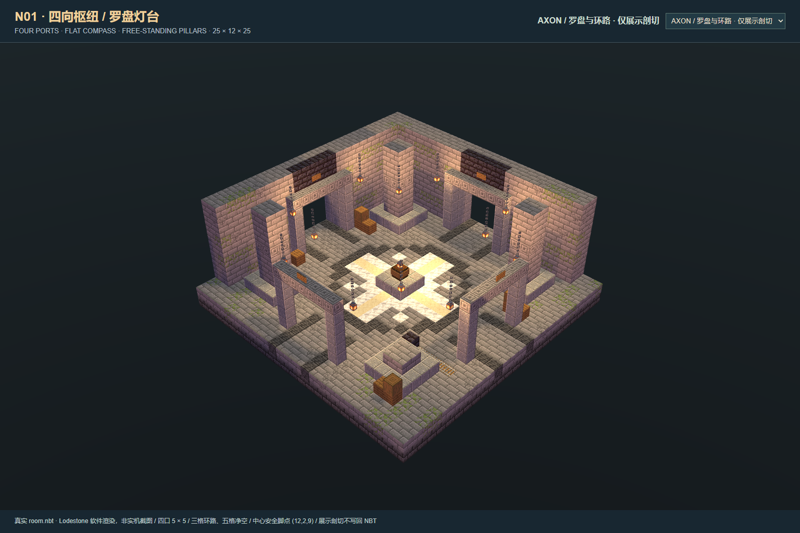

# N01 · 四向枢纽 / 罗盘灯台

独立交付：Minecraft Java 1.20.1，25 × 12 × 25，DataVersion 3465。依据同批 N01 四向枢纽概念图，以 Minecraft Builder / Lodestone 0.6.0 配方生成真实原版结构 NBT。正式实例、模组、房间注册表和玩家存档均未部署或修改。



## 交付与哈希

- `room.nbt`：gzip 压缩原版结构，7,500 条完整体积记录，其中空气 3,691 条；不含实体，含 12 个纯文字、已涂蜡告示牌方块实体。
- `room.json`：接口、地面、中心安全点、坐标、旋转与拼接约定。
- NBT SHA-256：`e605ff944681a414ab25c113388e51863a37f987417456bd0244d74315737f63`。
- 参考图 SHA-256：`fc72ab0f0f5650c07a959cf31a1de9bbb263af60ca5d7356d6255d35fac954fc`；与同批 `README.md`、`docs/manifest.json`、`docs/verify.json` 核对，证据见 `qa/reference.json`、`qa/static.json`。
- `qa.json` 为总验收；`delivery-manifest.json` 为交付文件逐项哈希，不包含 Gradle 缓存、编译输出和测试世界。

## 四向接口与安全区

所有坐标均为模板局部整数方块坐标，+X 东、+Z 南。地面完整方块 Y=1，玩家脚点 Y=2。四个接口均为 5 格宽 × 5 格高，Y=2..6；没有门、门槛或接口内装饰。

| 接口 | 脚点中心 | 边界开口 | 向内三格完整喉口 |
| --- | --- | --- | --- |
| N / 北 | (12,2,0) | X=10..14，Z=0 | Z=0..2 |
| E / 东 | (24,2,12) | X=24，Z=10..14 | X=22..24 |
| S / 南 | (12,2,24) | X=10..14，Z=24 | Z=22..24 |
| W / 西 | (0,2,12) | X=0，Z=10..14 | X=0..2 |

中心安全脚点为 **(12,2,9)**；区域 X=11..13、Z=8..10，平地 3×3、净空五格。推荐传送到块中心 (12.5,2,9.5)。几何正中心 (12,2,12) 是灯台实体障碍，不能用作落点。

三格宽主路：北支 X=11..13、Z=0..10；南支 X=11..13、Z=14..24；西支 Z=11..13、X=0..10；东支 Z=11..13、X=14..24。环路为 X/Z=8..16 扣除灯台 X/Z=11..13，共 168 格受保护路线，全部保留 Y=2..6 空气。任意接口之间都可绕灯台往返，四个两格见方立柱有独立柱脚并贯通至屋顶，吊链逐格接至屋顶。


## 旋转与未来拼接

采用原版 `StructureTemplate` 的原点旋转，pivot=(0,0,0)，无镜像。局部方位标牌随模板一同旋转，文字 N/E/S/W 指模板局部端口；世界方向请使用 `Rotation.rotate(Direction)`。旋转产生的负 X/Z 范围必须在占用检测内，不能只检查未旋转的轴向盒。

世界脚点 = origin + R(local)。从北向东依序旋转时 R(x,y,z)=(-z,y,x)；180° 为 (-x,y,-z)，逆时针90° 为 (z,y,-x)。四旋转实测世界入口、外接脚点、安全点与完整逐格 BFS 路径均记录于 `qa/forge-native.json`。

同高、同旋转的 N01 紧邻拼接原点平移为 N=(0,0,-25)、E=(25,0,0)、S=(0,0,25)、W=(-25,0,0)，旋转后对平移量同样应用 R。模板各占25格，接口的两层墙喉口已挖空，可无台阶接通。异形走廊按接口法线反向、脚点同高对接。当前测试在每个接口外另接 5×4 格测试地板，以原生碰撞验证边界到室内，测试桥不写入 room.nbt。

## 验收证据

| 项目 | 结果与证据 |
| --- | --- |
| 静态 QA | PASS；7,500 唯一坐标、原图链路、4接口喉口、完整地基屋顶、3×3安全区、三格环路、柱与灯链支撑；`qa/static.json` |
| 四向内外预览 | PASS；N/E/S/W 各一张内视及外视，8张均读取完整原始 NBT；另有剖视、平面、完整外观和接口示意；`qa/views.json` |
| Forge 原生 | MC1.20.1 / Forge47.4.10 隔离 GameTestServer，`StructureTemplate.placeInWorld` 四旋转；`qa/forge-native.json` |
| 状态稳定 | 初始与400 tick后每阶段30,000条方块记录一致，邻居更新全部触发，随机tick=3、火焰tick启用；13灯、4轨道、12牌/旋转存活且内容保持 |
| 原生连通性 | 每旋转472个原生玩家碰撞可行脚点（含外接测试桥）；4口×12有向路径均通过，合计48条/阶段，含全部外接边界；保存每条世界坐标路径 |
| 反例检查 | 7项全部拒绝：缺路面、堵接口、环路净空不足、安全点阻挡、落地灯支撑缺失、吊灯支撑缺失、标牌背板缺失 |
| 实际日志 | `qa/forge-run.log` 中 `N01_NATIVE_GAME_TEST_PASS` 与 `All 1 required tests passed`，Gradle `BUILD SUCCESSFUL` |


## 设计转换与限制

罗盘以深色环和方解石/砂岩星芒平嵌地面；中心独立灯台与四面导向牌、门楣深色牌背、四角柱、灰砖苔角和暖灯保留。木箱/桶在没有容器和奖励逻辑的前提下用木板与剥皮木作不可交互装饰；不放概念图矿车实体，只保留边角短轨与止挡。

剖视图仅隐藏屋顶、上梁、朝向相机的两面墙和前柱上段，以展示罗盘和路线；链条在剖切边界结束，不表示交付结构悬空。四向内外视和 `complete.png` 不剖切。全部为真实 NBT 软件渲染，非 Minecraft 客户端截图。原生测试不等于完整整合包、多人或 FPS 游玩验收。安全区指干燥、无碰撞障碍与无固有伤害，不含禁止未来敌对生物生成的运行时逻辑。

交付含显式空气，未来施工会清理对应位置；必须先检查旋转后完整体积与周界的方块、液体、方块实体及普通实体占用。本次没有施工，也未接入正式地牢清单。

## 重现

在 Minecraft Builder skill 目录运行：

```powershell
node scripts/run-build.mjs 'D:/ft工程文件/FT地牢_Image25接入_20261101/deliveries/zone-N01/source/recipe.mjs' --out-dir 'D:/ft工程文件/FT地牢_Image25接入_20261101/deliveries/zone-N01' --name room --data-version 3465 --json
```

在本交付目录运行 `node source/static-qa.mjs`。运行 `node source/serve-preview.mjs` 后，使用其打印的 URL 打开 `preview/interactive.html`，或将对应 base URL 传入 `node source/render.mjs`；`node source/interface-plan.mjs` 重建接口平面图。`powershell -NoProfile -File source/run-forge.ps1` 创建全新的隔离测试世界并执行 Forge QA；不会复用玩家世界。最后 `node source/finalize.mjs` 汇总证据并重新计算清单哈希。
