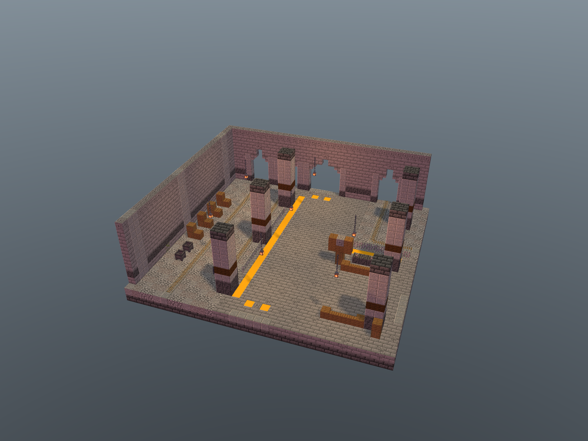
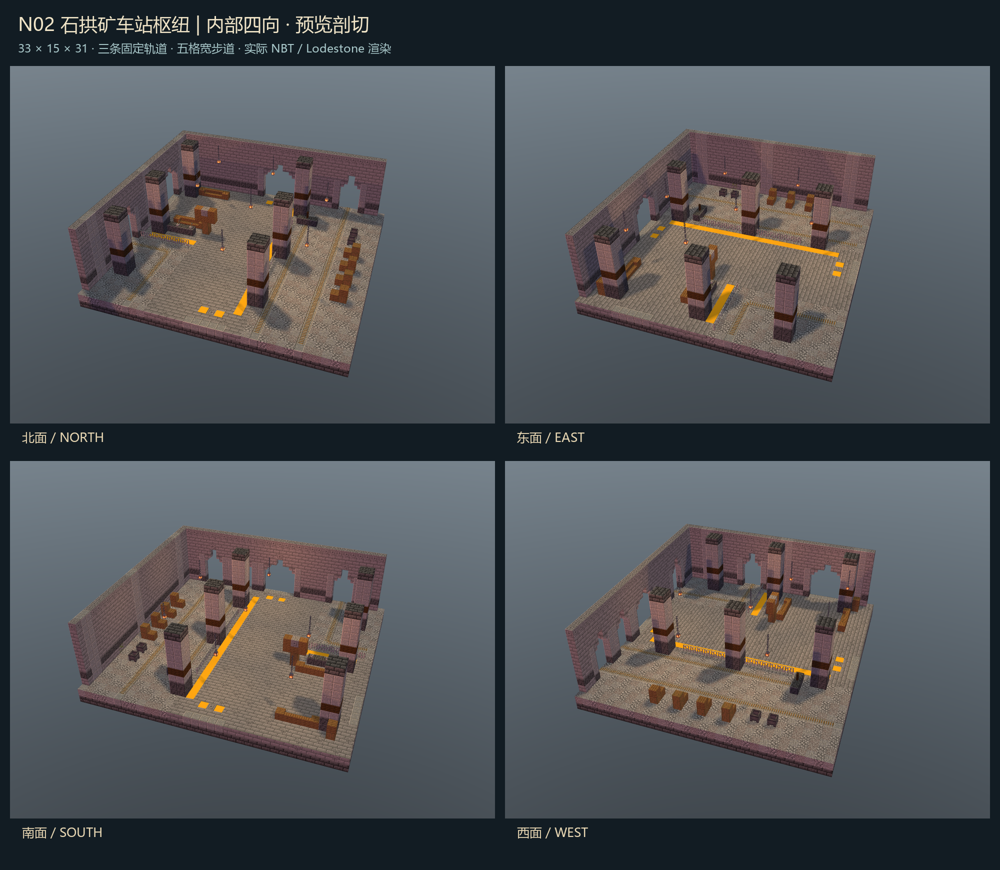
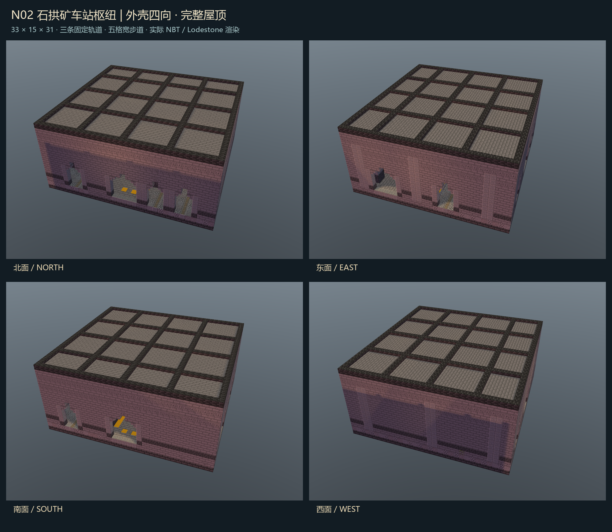

# N02 石拱矿车站枢纽 · 独立房间交付

状态：Minecraft Builder 制作、静态检查、四向内部/外壳软件视图、Minecraft 1.20.1 / Forge 47.4.10 原生四向放置和 200 tick 稳定性全部通过。未接入、未部署、未改正式实例或玩家存档。

## 四件套

- room.nbt：gzip、DataVersion 3465、单调色板，33×15×31，15,345 格完整记录，含显式空气。
- room.json：入口、安全点、步行/轨道接口、材料、图像指纹与接入条件。
- preview.png：最终 NBT 的 Minecraft Builder / Lodestone 0.6.0 南侧内部剖视。剖切仅作用于软件预览，NBT 保留完整屋顶。
- qa.json：验收结果和原生日志、捕获结构、视图及各项证据索引。

## 参考依据

原图：D:/ft工程文件/image2.5/dungeon-zone-batch-20261103/out/hub/N02-hub-minecart-station.png

原图 SHA-256：e1d1ea587fe2cfd8299af84f4a372b5cc089d6e4247e51d8505dc02dad1800b3

已阅读同批 README.md，核对 docs/manifest.json 和 docs/verify.json 的 N02 记录：2,130,390 bytes，1536×1024，RGB，ok=true，哈希一致。本次未调用任何付费生图接口。

保留石砖拱门、落地柱、木包箍、碎石道床、铁轨、链灯、木料堆、候车长凳、黄色安全线与调度台的主题。概念图中艺术化重叠的道岔改成三组固定独立轨道；站台与主路同高，采用黄色边线和铁栏隔离轨道区。釜仅作静态检修道具，不称为可乘坐矿车；调度台拉杆无接线、不控制轨道。

## 接口和安全点

全部坐标均是模板原点相对 XYZ。玩家脚位 y=2，脚下完整地板 y=1；轨道方块也在 y=2，完整支撑位于 y=1。北入口脚位 [16,2,0]，内部安全点 [16,2,3]，主要候车安全点 [20,2,20]。另有 [20,2,10]、[20,2,27]、[29,2,23]，全部通过三格净高碰撞通路检测。

| 步行接口 | 朝向 | 中心脚位 | 最小宽度 / 矩形净高 |
| --- | --- | --- | --- |
| pedestrian-north | 北 | [16,2,0] | 5 / 4 |
| pedestrian-south | 南 | [16,2,30] | 5 / 4 |
| pedestrian-east | 东 | [32,2,23] | 5 / 4 |

南北主路：x=14..18、z=0..30。东侧通路：x=16..32、z=21..25。合计 225 个主路脚位，至少三格净高，没有楼梯、关门、铁轨或危险地面挡路。原生搜索明确排除轨道脚位，五个安全点和三个外接短步道均可到达。

| 轨道接口 | 朝向 | 轨道坐标 | 原始形状 |
| --- | --- | --- | --- |
| through-north | 北 | [5,2,0] | north_south |
| through-south | 南 | [5,2,30] | north_south |
| siding-north | 北 | [10,2,0] | north_south |
| branch-north | 北 | [26,2,0] | north_south |
| branch-east | 东 | [32,2,11] | east_west |

三组轨道：x=5 南北直通 31 格；x=10 从北进入至 z=23 的 24 格终到线，在 z=24 有缓冲挡块；x=26 北入、在 [26,2,11] 使用 north_east 曲轨向东至 x=32，共 18 格。73 格内部轨道全部采用原版普通铁轨，下面均为完整磨制安山岩。所有接口向外延长时要保持轨道 y=2、支撑 y=1，并使用原生旋转转换曲线方向。

没有动力铁轨、自动道岔、矿车实体、奖励、刷怪或运输调度程序。矿车投放、动力和路线控制需后续单独设计与验收，不能从装饰拉杆推断已实现。

## 四向原生验收

独立工程：native-qa/，唯一 modId=ftn02qa，使用自己的 run-isolated/world；只在此可丢弃世界放置测试结构。未打开玩家世界，未改共享核心工程，未写入 mods 目录，也未改其他交付。

- 四个原生旋转 NONE / CLOCKWISE_90 / CLOCKWISE_180 / COUNTERCLOCKWISE_90 全部通过，单向检查 15,345 格。
- 强制测试区块 tick，并对结构施加邻居更新；等待 200 tick 后累计复核 61,380 格方块状态，四个世界捕获 NBT 均与旋转源体素逐格一致。
- 每向验证 73 格内部轨道、7 个链灯支撑、完整 1,023 格屋面、225 个主路脚位和 646 个可达无轨脚位。
- 每向实际外接三个两格长步道与五个两格长轨道短段；10 格外接铁轨稳定，所有外接步道可达。外接短段只存在于测试世界，不包含在 room.nbt 范围内。
- 缺轨道地板、缺吊灯链、堵主路、空气体积被占用四类故障探针，各旋转均被验收器检出；恢复后再运行稳定性验证。
- 0 液体、0 掉落物/实体、0 方块实体或容器库存。全部方块 ID/属性经原版注册表解码，原生模板往返与捕获重新加载通过。

日志：qa/forge-gametest.log，含 N02_NATIVE_PASS rotations=4/4 records=61380 ticks=200 与 BUILD SUCCESSFUL。原生报告：qa/native.json；世界捕获：qa/native-placed-*.nbt；静态报告：qa/static.json。

8 张四向图与 3 张视点图均为实际 NBT 软件渲染，可解码检查和逐图哈希见 qa/image-decode.json、qa/views.json。人工图像复核记录见 qa/visual-review.json。这些图不是 Minecraft 客户端截图，隔离 Forge GameTest 也不等于完整整合包客户端、多人或矿车运行验收。

## 接入约束

接入负责人需先检查整个旋转体积（含显式空气）及世界边界、实体、液体和占用；遇占用拒绝施工，不强制清空。维护房间独立持久生成标记，已生成/被玩家修改的房间不得重复覆盖。占用负探针只验证本交付测试器的方块体积拒绝；没有宣称实现核心完整占用/幂等系统。

qa/rotated-interfaces.json 提供四向接口和安全点坐标，采用旋转后包围盒最小点为原点。原生 StructureTemplate 的 pivot-origin 变换约定不同，接入时需对应平移；旋转后尺寸为 NONE/180:33×15×31，90/270:31×15×33。原生测试严格用 StructureTemplate.transform 变换各接口，并验证实际放置。

保持北侧中央步行入口及南/东接口完整连接；不能只把 NBT 打包就声称完成 FT 枢纽接入。本次没有验证既有返程、个人记录或正式大厅连接，也没有改动它们。

## 复现和指纹

生成：在 C:/Users/YOUR_USERNAME/.codex/skills/minecraft-builder-skill 中运行 node scripts/run-build.mjs <本交付绝对路径>/tools/recipe.mjs --out-dir <本交付绝对路径> --name room --json。

静态：node tools/qa-static.mjs。原生：PowerShell 运行 tools/run-native.ps1。预览：技能 scripts/preview.mjs --nbt <room.nbt> --port 5392 --no-open，再运行 tools/render-views.mjs；Pillow 运行 tools/make-sheet.py 后人工看图。最后 node tools/finalize.mjs 汇总证据并写 SHA256SUMS.txt。

room.nbt SHA-256：163a640721931400ff07c1680fd34cf99e6b5bd0da86e046442ef33c5e3a90dc

四件套、原生捕获、视图、报告和可复现源码的逐文件指纹见 SHA256SUMS.txt；不对可变的 Gradle 缓存、构建临时目录或测试世界纳入最终清单。不要部署 native-qa 的测试模组。
