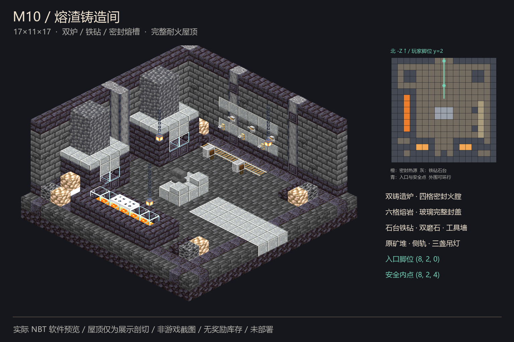

# M10「熔渣铸造间」独立交付

2026-11-02，Asia/Shanghai。四件套、静态 QA、Forge 原生四向放置与 600 tick 稳定性 QA 已通过；**未接入、未部署**。只制作 M10，不修改 FT 核心、生产 JAR、正式玩家存档或并行房间。不再调用 image2.5 API，零新增生图请求。

## 交付与接口

本目录根部即交付目录：`room.nbt`、`room.json`、`preview.png`、`qa.json`。`checksums.json` 包含四件套完整 SHA-256 和字节数，`qa/` 保存检测与图像证据，`tools/` 保存可复现源码。

- Java Minecraft 1.20.1，DataVersion 3465，gzip 单一调色板结构模板。
- 模板尺寸 **17×11×17（XYZ）**，3,179 条记录，1,673 格非空气，32 个原生合法状态。
- 北向入口 `entrance=[8,2,0]`，内部安全点 `interior=[8,2,4]`；均为模板相对整数脚部坐标，地板为 y=1。
- 北开口净宽 3、净高 3，向内六格维持三宽三高净空；没有门、地毯或突出门槛。入口、安全点与 11 个工作站接近点均可双向步行到达。
- 规划模板名 `ftdungeonmobs:image25/m10` 仅为建议，**没有注册或占用固定槽位**。
- 最终 NBT SHA-256：`f60332bfa687c834b1ef86f0d1c41f3c2d65f256b11bf088d46a9c9ebe329515`。



## 设计图与落地取舍

原图：`D:/ft工程文件/image2.5/dungeon-rooms-medium-random-20261102/out/M10-slag-foundry-hero.png`，1536×1024，2,003,117 字节；SHA-256 `1fcca8784da261c65ee881026b0c6a1d2640a31c86195f1c6c3287c1f0e232f4`。本目录 `reference/` 保留逐字节一致的原图副本。批次说明与总 manifest 只读使用，未改写。

保留双座黑石铸造炉、双烟囱、中央石台铁砧、左侧熔渣槽与铁格盖饰、右侧工具墙和地轨、双磨石、原矿堆、三盏锁链吊灯，以及耐火石构框架。双炉为手工砌筑的常燃火膛陈设，不是自动生产机器；未引入新配方、刷怪、库存或奖励机制。

为满足三格接口、设备支撑与两侧绕行，将约 13 格概念占地合理扩大为 17×17；总高 11 格包含双层地基和完整屋顶。木梁与木箱改为玄武岩/黑石梁及矿石堆。工具墙用杠杆、绊线钩作为原版静态视觉代用品，不使用掉落物、展示框、盔甲架或其他实体。

## 热源与建筑安全

- **熔岩 6 格**：`x=2,y=2,z=6..11`，源方块；底、左右与端面为完整石材，顶面为完整玻璃。上方铁活板门只是格栅装饰，不承担密封。没有玻璃板、开放熔岩缝或裸露岩浆块。
- **火 4 格**：`[4,3,14]`、`[5,3,14]`、`[11,3,14]`、`[12,3,14]`；下方地狱岩，前窗为完整玻璃，其余面为石材或相邻同炉火格。整个火膛六面封闭，没有可燃构件。
- 熔槽外围为黑石挡边；三格北路、铁砧两侧、炉前、磨石前和熔槽前都是干燥接近点，主路不穿热源。
- 铁砧、两只磨石和六格铁路均有完整支撑；六件墙饰具备墙体锚点；三灯、八格锁链均向上连续连接实体承梁。
- 基础和地板各 289 格，屋顶完整 289 格。展示剖切只存在于软件视图，最终 NBT 没有削顶。
- 零可燃方块、零方块实体、零模板实体、零容器、零奖励库存、零战利品表、零刷怪笼、零指令/结构/拼图方块。

`qa/heat-sections.png` 从实际 NBT 绘制熔槽横剖面与炉膛纵剖面，明确显示完整玻璃、石围挡与地狱岩基座。

## QA 证据与真实结果

1. **`qa/static.json`**：独立重读已经序列化的 NBT，核验 gzip、DataVersion、单调色板、完整记录、坐标唯一性与边界、材料限制、三格北接口、完整地板/屋顶/围墙、六面热源密封、设备/吊链/墙饰支撑、双向路线和图片指纹。保守的平面可达脚位为 148 格。
2. **`qa/native.json`**：Java 17.0.8 / Minecraft 1.20.1 / Forge 47.4.10 的真实 `GameTestServer`，调用原生注册表、属性解析、`StructureTemplate.load/save` 与 `StructureTemplate.placeInWorld`；不是只解码 NBT 或自写模拟器。
3. 原件按 0°、90°、180°、270°独立放置。初始和稳定后各比较 **12,716 条方块记录**；每向验证 1,673 格非空气的原生 `canSurvive` 与六面 `isFlammable`，并核验原生碰撞、支撑、三宽三高入口、完整屋顶和 1,514 格外围留白。
4. 四个夹具区强加载，启用火蔓延、随机 tick 速度 3，显式调度熔岩与普通火 tick，真实运行 **600 个游戏 tick**。四向均保留 6 格源熔岩、4 格炉火、全部灯链和设备，无外溢、新增火、掉落实体或材料变动。火的正常 age 更新不被误判成结构损坏。该时长不是 600 秒，也不是长期压力测试。
5. 原生碰撞感知路径允许安全的一格升降，因此每向可达干燥脚位为 **163 格**，11 个设备/环路接近点全部往返可达。与静态 148 格算法口径不同，不冒充相同计数。
6. 成功完整日志为 **`qa/gametest-20261102-123320.log`**，含 `M10_NATIVE_GAME_TEST_PASS: rotations=4/4; records=12716; ticks=600; sha256=f60332bfa687c834b1ef86f0d1c41f3c2d65f256b11bf088d46a9c9ebe329515`、`All 1 required tests passed` 与 `BUILD SUCCESSFUL`。
7. **`qa/render.json`、`qa/visual-review.json`**：实际 NBT、原版 1.20.1 方块模型与纹理的软件预览；已逐张查看主预览、四向剖面、屋顶外观、平面图与热源剖面。流体形体使用源格近似，动画取首帧，没有烘焙游戏内照明；封闭炉火在等角视角下部分受炉梁遮挡，以剖面和原生火格计数补证。不是 AI 图替代成品，也不是整合包游戏截图。

### 失败与修正记录

首轮真实原生检查发现 `minecraft:coal_block` 可燃并失败。将四格煤炭块全部替换为不可燃的 `deepslate_coal_ore` 后，在新的独立临时世界重跑并通过全部四向与稳定性检测。

- 原始失败日志：`qa/gametest-20261102-122811.log`。
- 失败模板：`qa/attempt1-coal-block.room.nbt`，SHA-256 `561e437da081caadfd29905accdd775f93e6a831cba54669c9cae656f3969d45`；仅为审计证据，不可误用于交付。
- 首轮静态检查未识别煤炭块的可燃性；已扩充静态禁用清单，最终安全结论同时以原生六面可燃性检测为准。`qa/attempt1-static.json` 保留旧结果，不把它冒充最终通过证据。
- `qa/attempts.json` 逐轮记录日志指纹、结果、失败原因和模板指纹。
- Forge 首次运行自动创建临时 `server.properties`/配置，开发启动器存在弃用与版本检查提示；这些启动提示不等同于测试失败。首轮失败的决定性原因是可燃煤炭块。

## 复现

在本工程根目录运行；不要在正式 Minecraft 实例中执行这些测试。

```powershell
$python = 'C:\Users\YOUR_USERNAME\.cache\codex-runtimes\codex-primary-runtime\dependencies\python\python.exe'
& $python -X utf8 -B tools/build_m10.py
& $python -X utf8 -B tools/render_m10.py
& .\tools\run_forge.ps1
```

构建会把根 `qa.json` 重置为待原生验收。重新人工查看最终预览并更新 `qa/visual-review.json` 后，运行 `tools/finalize_m10.py`；终检严格比对最终 NBT、预览、原生报告、完整成功日志及人工视审指纹，并更新 `qa.json`、`checksums.json`。不能沿用旧 PASS 绕过复检。

`run_forge.ps1` 使用本机 Java 17 和已缓存的 Gradle 8.8 / ForgeGradle 6.0.54，离线构建，每轮选择独立的 `qa/forge-runs/<时间戳>/`，保留失败世界且不清空任何玩家世界。Gradle 日志独立编号。运行时缓存可能由 Gradle 正常更新，不属于生产部署。

`tools/nbtio.py`、`tools/mc_models.py` 和空测试夹具模板从已经交付的 M6 工程只读复制到本工程：NBT 工具原始 SHA-256 `3b1d85f5e032fba12287355b2f9616d8ad5505ae6c7ea97cc06ca74067a34586`，渲染基础工具 `3dcf748f3378116d22a72e2a1654e2b4e7ee88a1dd551aab09c6d821f9993bc6`。没有修改原工程；M10 建筑、热源安全检查、原生测试与最终预览逻辑独立实现。

## 并行与接入边界

本次业务产物只写本目录；没有写共享 `incoming/`、队列、核心注册表、其它房间目录、正式 mods 或正式 saves。未提供玩家世界施工命令。

后续由统一接入负责人分配槽位和大厅连接，并验证**整个模板体积（包括显式空气）**的占用拒绝、世界边界、液体/实体安全、幂等和持久生成标记。不得用稀疏/空气记录作为无条件清空授权，不重建已有房间，不覆盖玩家修改，不改变既有返程记录、入场窗口和五档难度。

生产打包、停服备份、部署、回滚和整合包客户端/多人游玩验收均未执行。此时回滚无需动核心或存档；只需不接入此独立交付。`tools/` 中的测试模组仅供隔离 QA，不能放入整合包 mods 或打包进生产核心。
