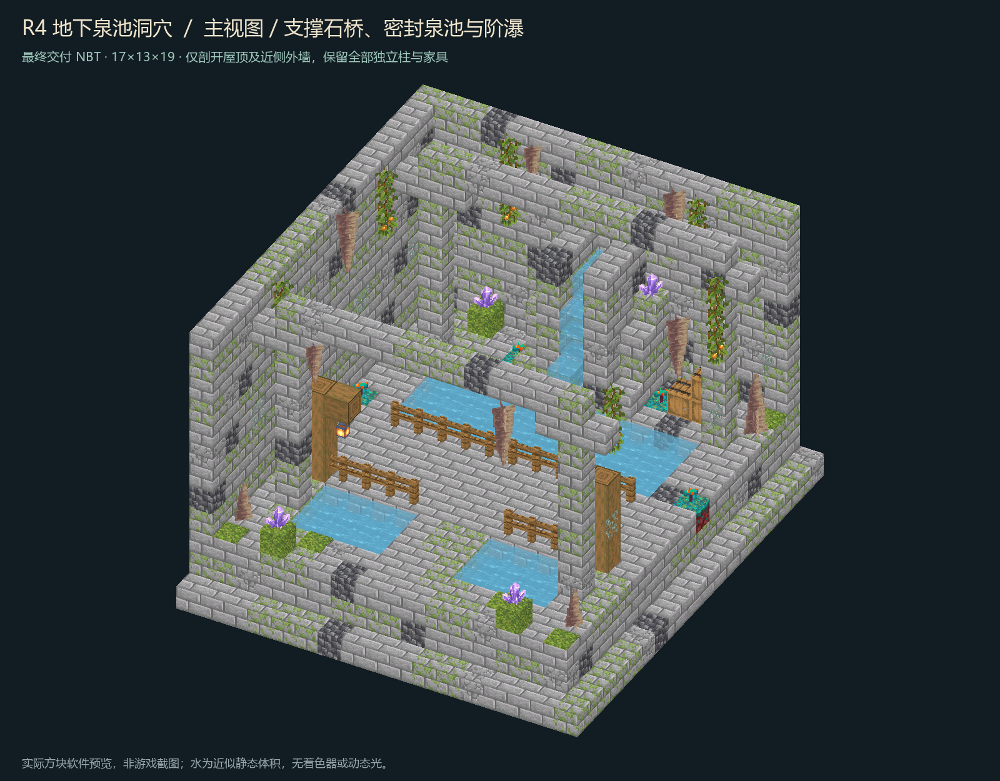

# FT 地牢 R4 · 地下泉池洞穴

本目录为 **独立房间候选**，不是正式部署。最终状态与全部证据见根部 `qa.json`；严格验收通过后才会生成该报告和发布 ZIP。不调用付费 image2.5 接口，不修改核心、其他线程房间或玩家世界。

## 四件套

| 文件 | 内容 |
| --- | --- |
| `room.nbt` | Minecraft Java 1.20.1 / DataVersion 3465；gzip 单一调色板，完整显式体积 |
| `room.json` | 制作编号、尺寸、北入口脚位、安全点、朝向和完整 NBT 指纹 |
| `preview.png` | 读取最终 NBT 与原版模型/贴图的软件剖视，不是概念图或游戏截图 |
| `qa.json` | 静态、原生四向、稳定性、回采逐格比对、重建和目视检查的汇总 |



## 原图与转译

- 来源 `D:/ft工程文件/image2.5/dungeon-rooms-medium-random-thread3-20261102/out/R4-underground-spring-cave.png`，1536×1024。
- 原图 SHA-256：`a8047daa62bd14344fbe2cfe04426b5577f5e2ddedbf2e2930c67d2c7be8b827`。本目录 `reference/` 保留同指纹副本。
- 原批 README/manifest 位于 `D:/ft工程文件/image2.5/dungeon-rooms-medium-random-master-20261102/`。概念尺寸只是近似；实际扩为 `17×13×19`，以保留两侧干岸、三格桥面和柱/摆设分离。
- 保留苔石古洞、双泉池、带栏杆石桥、两盏木臂吊灯、后墙泉瀑、钟乳石/石笋、垂藤、空桶堆与晶簇/青色菌菇。四根柱落地接顶，桥下六根实心桥墩；家具不穿柱，悬挂件有支撑。
- 只用原版 1.20.1 方块。概念图蓝晶改用紫水晶簇，青菌用诡异菌；不虚构蓝色光照、雾、粒子、绳索模型或可取奖励。光源为灯笼、浆果、发光地衣及水底海晶灯。

## 接口与水体

- 北入口脚位 `(8,3,0)`，内部安全点 `(8,3,3)`，入口三格宽三格高，地板 Y=2。两者均为玩家脚位，不是脚下地板坐标。
- 主干路三格宽连接横向三格净桥；两侧干岸可步行抵达。四向原生碰撞 BFS 每方向得到 116 个连通干脚位。
- 主池两格深、底板完整，桥下水层连通；后墙窄槽由真实水源下泄。生成器先用原生流体 tick 求平衡，固化新增七格水和两处栅栏连接；最终模板再从头执行严格四向测试，不把初始松弛测试当成最终通过。
- 完整屋顶保存在 NBT。仅渲染时剖开屋顶和近侧外墙；不会删除柱、梁、家具来掩盖问题。外观图和平面图在 `preview/`。

## 证据口径

- `qa/static.json`：4199 条完整体积记录、2136 非空气、193 水、3 空木桶；屋顶/地板、入口、干路、柱墩、支撑、水包络与零库存检查。八个内存破坏负例必须全部拒绝。
- `qa/native.json`、`qa/forge-gametest.log`：Java 17.0.8、Minecraft 1.20.1、Forge 47.4.10；合法注册表/属性、原生 NBT 往返、四向 `StructureTemplate.placeInWorld`、真实碰撞/BFS、所有状态 `canSurvive`、空容器、外圈无水及零新实体/掉落物。
- 四向共16796条状态在240 tick后严格检查；200与240 tick回采一致。关闭随机植物生长 tick 和自然刷怪，不关闭计划水流 tick；这不承诺植物永远不会自然长大。
- `qa/native-capture-comparison.json`：四向世界状态逆旋转后与源逐格一致；空列表 NBT 的类型/键序不改变空库存语义。`qa/reproducibility.json` 证明脚本加九处原生平衡状态可重建同一压缩指纹。
- `qa/visual-review.json` 关联本次主图、四向、平面、完整屋顶及原生回采的实际目视检查；软件不模拟动态光和真实流体网格，水为近似静态蓝色体积。

原始失败与修复不删证据：最初编译时 `StructureTemplate.load` 使用错误 lookup 参数，已修正；两次严格复跑因旧夹具拆除的植物/晶体掉落残留而拒绝，其中最后一向的旧实体异步延迟载入。另一次新世界复跑发现地下夹具外圈受天然含水层影响。现已禁止夹具拆除时的形状传播/掉落，每次使用新建带时间戳世界，并将四个夹具放在 Y=256 高空隔离天然地形；放置后仍严格禁止新实体/掉落并检查全部外圈无水。旧日志及失败报告保留为 `qa/previous-*`。夹具清空受 `GameTestServer` 限制，从未触碰正式世界。

## 复现

Python 使用 `C:/Users/YOUR_USERNAME/.codex/.venvs/imagegen/Scripts/python.exe`，只需 Pillow；这里不会调用 imagegen CLI。原版渲染资源只读 `C:/Users/YOUR_USERNAME/.gradle/caches/forge_gradle/minecraft_repo/versions/1.20.1/client.jar`。

在此目录运行：

```powershell
$python = 'C:/Users/YOUR_USERNAME/.codex/.venvs/imagegen/Scripts/python.exe'
& $python tools/build_room.py --rebuild-final
& $python tools/qa_static.py
& $python tools/run_native.py
& $python tools/render_room.py
```

`run_native.py` 默认离线调用本机 Gradle 8.8 与 Minecraft Java 17；可传 `--gradle`、`--java-home`。测试世界仅在本目录 `qa/forge-run-<时间戳>/`，旧诊断世界 `qa/forge-run/` 保留，不删除。结构改动后必须重新验收、重新打开图片并更新视觉报告，旧指纹不能通过 `finalize_delivery.py`。

如需从原始水源重新求平衡：`build_room.py` → `run_native.py --bootstrap` → `build_room.py --adopt-native` → 严格原生复测；此流程会保留旧日志。日常重建请用 `--rebuild-final`，不要用不带参数的初始模板冒充最终文件。

独立发布包位于 `release/`，不包含测试世界、Gradle 缓存、构建目录或可安装 JAR。后续正式接入的占用拒绝、真实大厅连路、幂等、存档、回滚和客户端验证必须另做，详见 `HANDOFF.md`。
