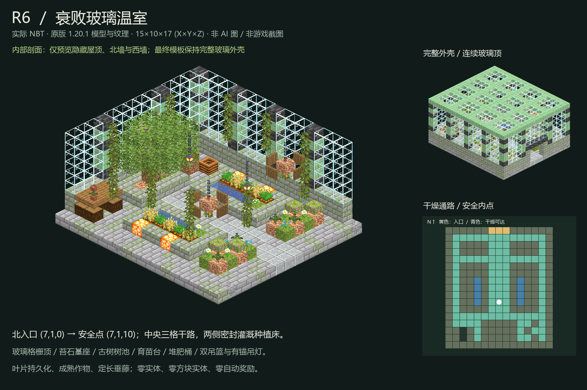

# R6 · 衰败玻璃温室

独立制作目录：`D:\ft工程文件\FT地牢_R6_衰败玻璃温室_20261102`。

## 正式交付

| 文件 | 用途 |
| --- | --- |
| `room.nbt` | Minecraft Java 1.20.1，DataVersion 3465，gzip 单调色板结构 |
| `room.json` | 尺寸、入口、内部安全点、参考图、NBT SHA-256 与主题坐标 |
| `preview.png` | 从最终 NBT 读取的原版纹理软件预览，非 AI 成品替代图、非实机截图 |
| `qa.json` | 静态、负例、Forge 原生放置、稳定性与证据哈希汇总 |
| `delivery-manifest.json` | 交付文件、工具、原生测试源码及证据的完整 SHA-256 清单 |



## 布局

- 尺寸 **15×10×17**，顺序为 X×Y×Z；2550 条完整体积记录，含显式空气，1263 个非空气方块。
- 北入口为玩家脚部 `(7,1,0)`，净空 3×3；内部安全点 `(7,1,10)`。入口下完整地板，坐标不可误当成地板坐标。
- 中央 `x=6..8,z=0..12,y=1` 保留三格宽干路；树池在后区，侧通道绕过花床。水槽不占用主路。
- 四周有玻璃和铜框架，底部苔石墙裙；北侧只留规定接口。屋顶 255 格全部保留，玻璃顶并非预览剖面中的缺顶。
- 两排灌溉花床含 8 个水源、10 株成熟作物，4 个嵌入式菌光体保证夜间照明；另有土壤支撑的蕨、杜鹃、花卉和盆栽。
- 后方树池、持久化橡树/开花杜鹃树叶、育苗工作台、堆肥桶、两个链条吊篮、两个高位链条吊灯及顶锚定长垂藤构成温室主题。
- 原图中央明渠改到两侧密封花床，以保持三格干路。原图中非原版瓶罐、麻袋和手推车改为原版盆栽台、堆肥桶和土料。

## 参考来源

原图：`D:\ft工程文件\image2.5\dungeon-rooms-medium-random-thread3-20261102\out\R6-overgrown-greenhouse.png`，1536×1024。

SHA-256：`525b5a4b3c1043be2d45abe0502274509c0d5f1ffa376bb1251a4a964aee13ee`。

遵循 `D:\ft工程文件\FT地牢_Image25接入_20261101\CONTRACT.md` 和中等随机房间主清单。未重新调用 image2.5，不产生额外生图请求。

## 验证层级

1. `qa/static.json`：重读实际 NBT；完整体积、边界、入口、干路、支撑、屋顶、玻璃壳、水密封、持久树叶、成熟作物与禁用内容。
2. `qa/negative.json`：内存中注入缺屋顶、破玻璃、堵入口、缺地板、无作物基座、无藤蔓顶锚、漏水侧壁、堵安全点、吊灯断链，共九个负例；不保存损坏结构。
3. `qa/native.json`：独立 Java 17 / Forge 47.4.10 GameTest 世界中，严格注册表/属性读取、StructureTemplate 加载/保存、四向每向两次放置、原生 `canSurvive` 和玩家碰撞体、完整屋顶与玻璃壳、流体外溢扫描、支撑及通路。
4. 测试使用现有 FT 核心同款 `setKnownShape(true)`、`setKeepLiquids(false)` 和 flags=18；光照传播 20 tick 后触发全体邻居更新，再运行 200 tick，`randomTickSpeed=3`，固定午夜，并强制所有房间区块持续 ticking。
5. `qa/preview.json`：从最终文件渲染的模型/纹理清单、预览哈希与软件渲染限制。仅预览移除屋顶、北墙和西墙，完整外壳另见 `qa/full-shell.png`。

最终状态以 `qa.json`、`qa/native.json` 和日志中的 `R6_NATIVE_PLACEMENT_PASS`、`All 1 required tests passed`、`BUILD SUCCESSFUL` 为准，不能将本说明当作测试执行证据。

首次使用不匹配生产时序的 `UPDATE_ALL` 试验曾发现作物在光照尚未传播时脱落，失败日志完整保留。修正加入床沿照明，并按已有 FT 核心的已知形状放置契约验证；未修改核心绕过问题。非生产放置方式不能冒称通过。

## 复跑

```powershell
& 'D:\ft工程文件\FT地牢_R6_衰败玻璃温室_20261102\Run-QA.ps1' -Rebuild
```

依赖本机现有 Java 17、ForgeGradle 6.0.54 离线缓存、bundled Python/Pillow、1.20.1 原版客户端资源 JAR。脚本只写本独立目录和常规 Gradle 缓存，创建的是本工程测试世界，不打开正式 Minecraft 客户端或玩家存档。QA Mod 仅开发测试使用，**禁止部署**。

## 并行与接入边界

本次不写 `incoming/`、房间 catalog、固定世界槽位、道路、正式 JAR、mods 或玩家存档；不更改门、火盆、五档难度、个人返程记录、生成标记与其它线程房间。四向重复模板放置不等于核心幂等/占用拒绝验收。

后续唯一接入负责人需确定 slot/origin、连接大厅、复验全体积占用/液体/实体拒绝和持久标记，再另行协调部署。本交付不是整合包客户端视觉、多人、FPS、长周期天气或玩家耕地踩踏测试。
