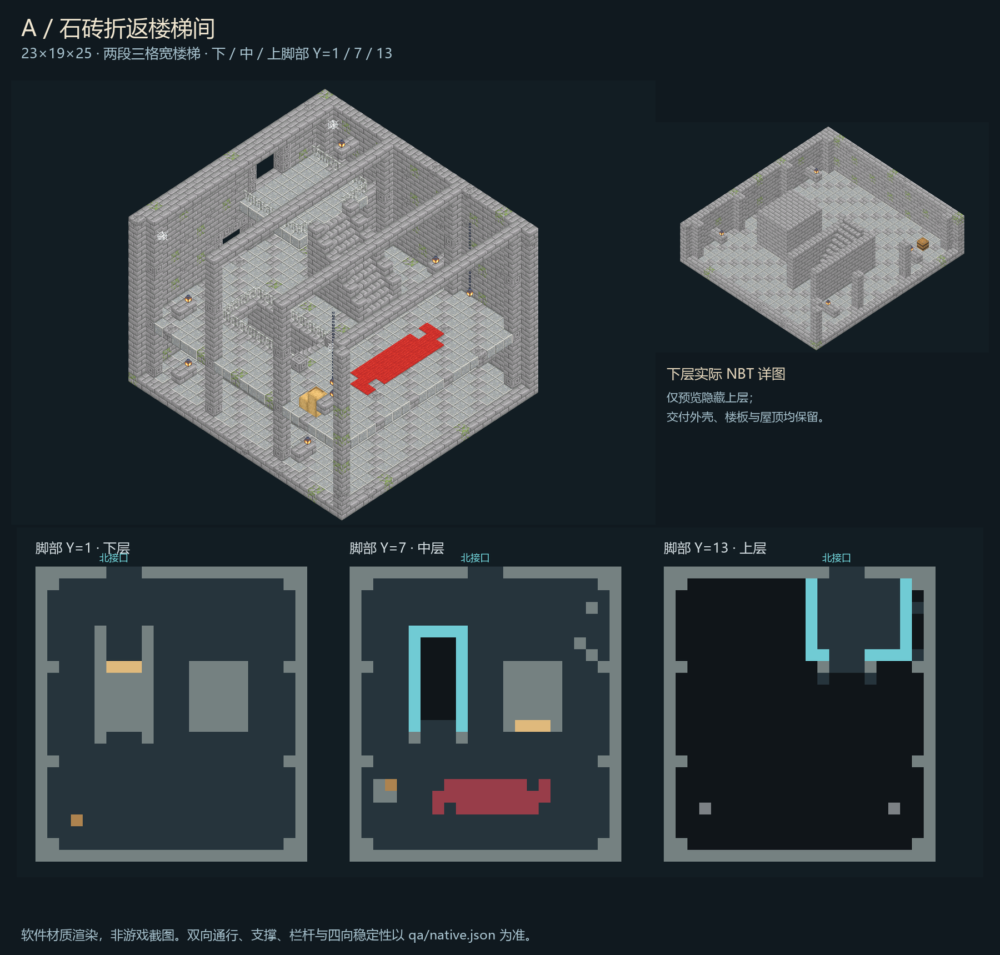

# A · 石砖折返楼梯间 · 独立候选交付

制作日期：2026-11-02（Asia/Shanghai）。Java 1.20.1 / Forge 47.4.10 / DataVersion 3465。

## 成品与设计

- 根目录 `room.nbt`、`room.json`、`preview.png`、`qa.json` 是完整交付；`out/` 保留相同四文件、材料表及 SHA-256 清单。
- 实际结构为 **23×19×25**，单一调色板、gzip NBT，含 10,925 条显式方块记录；屋顶与外墙完整，只有三个声明的北向接口开口。
- 两段各 6 级、3 格宽的石砖楼梯反向排列，经南端公共石平台折返。所有 36 个台阶均有连续石砌基础；下行洞口有三边铁栏与出口柱，上行段有石质阶梯护墙，上层平台有铁栏。
- 保留苔石/裂石砖、凿纹石柱、墙托灯笼、屋顶锚定吊链、红毯、木箱/空桶与墙角高处蛛网。木箱用原版去皮橡木模拟，两个桶均为空，不生成物品或战利品。
- 原设计：`D:/ft工程文件/image2.5/dungeon-stair-rooms-20261102/out/stair-switchback.png`，1536×1024。SHA-256：`5c5f70a5a6fc3ca28abdb037c32f3c8ba3d95d14f0d2a2b3bdc60fc5f1c75d1e`。
- 交付 NBT SHA-256：`86f156cef5a3e467489d56fa54542a12494ae879a1fda837b45ef46c85c7e677`。



预览来自最终 NBT 和原版 1.20.1 模型/纹理，不是 AI 概念图或客户端截图。四向、完整外壳、下层详图、西侧剖面、分层平面和原生回采预览位于 `preview/`。下层详图仅在内存中隐藏上层，保留末级台阶；剖切清单在 `qa/render-*-cuts.json`，不改交付 NBT。

## 接口与相对坐标

所有坐标是模板原点相对 XYZ，接口坐标指玩家**脚部**，不是脚下方块。北向为 -Z。

| 用途 | 脚部坐标 | 净开口 | 地板顶面 |
| --- | --- | --- | --- |
| FT 主入口（北侧中央） | (11,7,0) | X=10..12，Y=7..9 | Y=7 |
| 下层预留接口 | (7,1,0) | X=6..8，Y=1..3 | Y=1 |
| 上层预留接口 | (15,13,0) | X=14..16，Y=13..15 | Y=13 |
| 内部安全点 | (11,7,16) | 公共折返平台 | Y=7 |

主路先从中层北入口沿 X=10..12 走向南端平台，再向西折入下行梯段，或向东折入上行梯段；上下接口都返回北墙，是真实连通的高度变化，不是装饰台阶。中层入口高于最底接口 6 格，不能按普通 Y=1 房间无阶梯平接。`room.json` 的 `connections` 保留三个接口供接入负责人分配。

三个外部接口以模板边界为验收终点。正式接入前必须另行预留外部 3 格宽落脚台、走廊和坠落保护；本候选不擅自改变 FT 路线或替核心选择槽位。

## 已执行验证

- `qa/static.json`：43 项静态检查通过，包括图/模板指纹、唯一记录、完整顶底与除门洞外的外壳、每级连续基础、栏杆、入口/安全点、灯链地毯支撑和空容器。
- `qa/native.json`：隔离 Forge GameTest，真实原版注册表和属性、方块实体解码、原生模板往返、`StructureTemplate.placeInWorld` 四向放置（0/90/180/270°）全部通过。
- 每个方向首次与稳定后逐格复核所有 10,925 条记录，稳定后总计 **43,700** 条；全部 `canSurvive`、邻居形状固定点、36 台阶/53 栏杆与护墙/24 灯链锚点、3 个 3×3 接口、2 个空桶通过。
- 对下层与上层连接各测 3 条横向行走带，并分别来回：4 方向共 **48 条路径**。采用原生碰撞体积 0.6×1.8、水平 0.25 格采样、最大垂直步进 0.6 格，实际台阶最大步进 0.5 格，无须跳跃；验证安全点、地板与路线净空，不穿流体或蛛网。
- 四向均执行缺失台阶基础、缺失护栏、缺失灯笼锚点与堵住中央通道的拒绝探针，共 16 项，全部能拒绝；恢复探针后向全部方块发送邻居更新，保持区块加载，再等待 **100 个真实世界 tick**，状态无漂移、无掉落/实体，容器仍空。
- 原生世界四向回采 NBT 为 `qa/native-placed-*.nbt`。日志 `qa/forge-gametest.log` 同时包含 `STAIR_A_NATIVE_GAME_TEST_PASS: rotations=4/4`、`All 1 required tests passed` 与 `BUILD SUCCESSFUL`。

这些是静态与**独立、无客户端的 Forge 原生世界验证**，不冒充完整整合包客户端/多人游玩、FPS 或核心接入测试。日志有一次初始化 `Can't keep up` 提示，不据此宣称性能达标。行走探针使用原生碰撞形状，不是真人按键/冲刺/跳跃模拟。

## 并行边界与接入前置条件

只在此独立目录写入；没有部署、修改 FT 核心/目录、其他房间、正式 `mods/` 或玩家存档，也没有再次调用收费生图接口。候选 ID 为 `STAIR_A`，由唯一接入负责人审核后确定正式 ID/槽位和刷怪分类。

遵循 `D:/ft工程文件/FT地牢_Image25接入_20261101/CONTRACT.md` 及核心 `ROOM_IMPORT.md` 的职责边界。正式接入还必须验证：完整体积加缓冲的占用/液体/实体拒绝、从 FT 大厅实际可步行的连接、三个外部平台安全、独立持久化标记和幂等、已有房间不重建、返程和难度/刷怪规则回归。显式空气不是清空任何旧地形或玩家建筑的授权。

本目录的 `src/`、`build.gradle` 与 GameTest 仅是验收夹具，**绝不能当正式模组安装**。撤回候选只需停止接收此交付，不涉及玩家世界回滚；未来部署必须经核心负责人协调并停服备份，不盲删旧生成标记。

## 可重复执行

在本目录使用已配置的 Python 3.12/Pillow 环境：

```powershell
$python = 'C:/Users/YOUR_USERNAME/.codex/.venvs/imagegen/Scripts/python.exe'
& $python tools/build_room.py
& $python tools/qa_static.py
& $python tools/run_native.py
& $python tools/render_room.py
& $python tools/finalize_delivery.py
```

`run_native.py` 使用本机既有 Gradle 8.8、Java 17 和已缓存 Forge，离线运行并把世界放在此目录 `qa/forge-run/world`，不打开玩家世界。反复运行会在隔离测试区重新放置；历史报告/日志以 `previous-*` 另存。`nbtio.py`、原版模型解析器基础与 runner 复用了本机已交付商店 C 的工具并复制到此目录；不反向修改来源工程。
